<p align="center">
  
</p>

<p align="center">
  Aplikasi desktop kedai ramen, dikerjakan bertahap per pertemuan <b>Praktikum Rekayasa Perangkat Lunak 2</b>.<br>
  Disusun oleh <b>Bima Gunawan</b>, NPM 50423276, kelas 4IA24, Universitas Gunadarma.
</p>

<p align="center">
  <a href="#-tahapan">Tahapan</a> ·
  <a href="#-tampilan-aplikasi">Tampilan</a> ·
  <a href="#️-struktur-database">Database</a> ·
  <a href="#-susunan-kode">Kode</a> ·
  <a href="#️-cara-menjalankan">Menjalankan</a> ·
  <a href="#-materi-lp-tp-dan-laporan-akhir-per-pertemuan">Materi</a>
</p>

---

## 🍜 Tentang proyek

RamenKu membantu kedai ramen mengelola **stok bahan**, **menu beserta resepnya**, dan **penjualan di kasir**, lengkap dengan **laporan** yang bisa diunduh. Satu proyek yang terus bertambah: lapisan datanya berpindah dari JDBC ke Hibernate lalu dikelola Spring, dan laporannya kini keluar sebagai PDF, Word, dan Excel.

| | Teknologi | Dipakai untuk |
|---|---|---|
| ☕ | **Java 17**, Swing, FlatLaf | tampilan desktop |
| 🗄️ | **MySQL** (XAMPP) | basis data `ramenku_db` |
| 🔌 | **JDBC** | akses data pada Pertemuan 3 |
| 🧬 | **Hibernate** (JPA) | pemetaan objek ke tabel (ORM) |
| 🌱 | **Spring** (DI, transaksi, AOP) | pengelolaan DAO dan transaksi |
| 📄 | **JasperReports** | laporan stok dan struk: PDF, Word, Excel |
| 🧪 | **JUnit 5** | 21 tes otomatis |

## 🪜 Tahapan

Praktikum berlangsung setiap hari Jumat pagi.

| # | Tanggal | Materi | Hasil di RamenKu |
|:-:|---|---|---|
| 1 | 16 Okt 2026 | Rancangan aplikasi ERP | rancangan berupa dokumen, belum ada kode ([pertemuan-1](pertemuan-1)) |
| 2 | 23 Okt 2026 | **OOP** Java | Encapsulation, Inheritance, Polymorphism di paket `id.ramenku.oop` ([penjelasan](README-OOP.md)) |
| 3 | 30 Okt 2026 | **MVC**: login dan JDBC | login, tiga fitur (Menu dan Resep, Stok Bahan, Penjualan) dengan JDBC ke MySQL, dan laporan PDF |
| 4 | 6 Nov 2026 | **ORM**: Hibernate | lapisan data pindah ke Hibernate (entitas, HQL, transaksi) |
| 5 | 13 Nov 2026 | **Spring** Java | Spring mengelola Hibernate lewat DAO: Dependency Injection, transaksi deklaratif, AOP ([pertemuan-5](pertemuan-5)) |
| 6 | 20 Nov 2026 | **JasperReports** | laporan diunduh sebagai PDF, Word, dan Excel, dengan tampilan aplikasi dan laporan yang baru ([pertemuan-6](pertemuan-6)) |
| 7 | 27 Nov 2026 | menyusul | diisi setelah pertemuan berlangsung ([pertemuan-7](pertemuan-7)) |
| 8 | 4 Des 2026 | **Manual Book** RamenKu | [pertemuan-8](pertemuan-8) |

## 🖼️ Tampilan aplikasi

Sejak Pertemuan 6, RamenKu memakai tampilan baru dengan warna bahan ramen: krim kaldu, cokelat shoyu, oranye miso, dan kuning mi. Laporan PDF, Word, dan Excel ikut memakai warna yang sama.

<table>
  <tr>
    <td width="50%">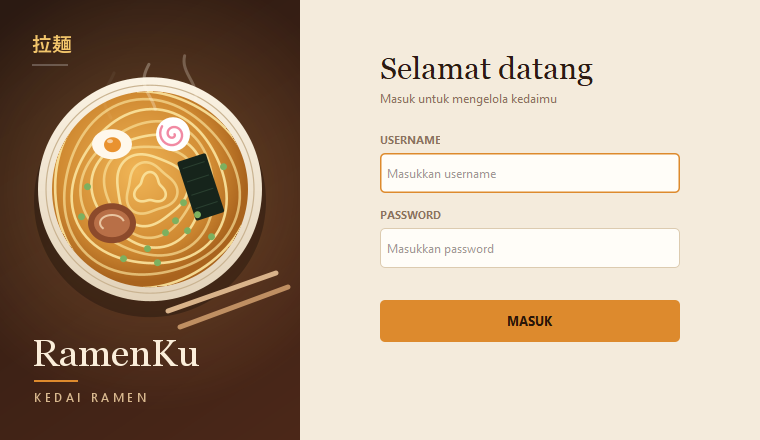<br><sub><b>Login</b> dengan mangkuk ramen dilihat dari atas</sub></td>
    <td width="50%">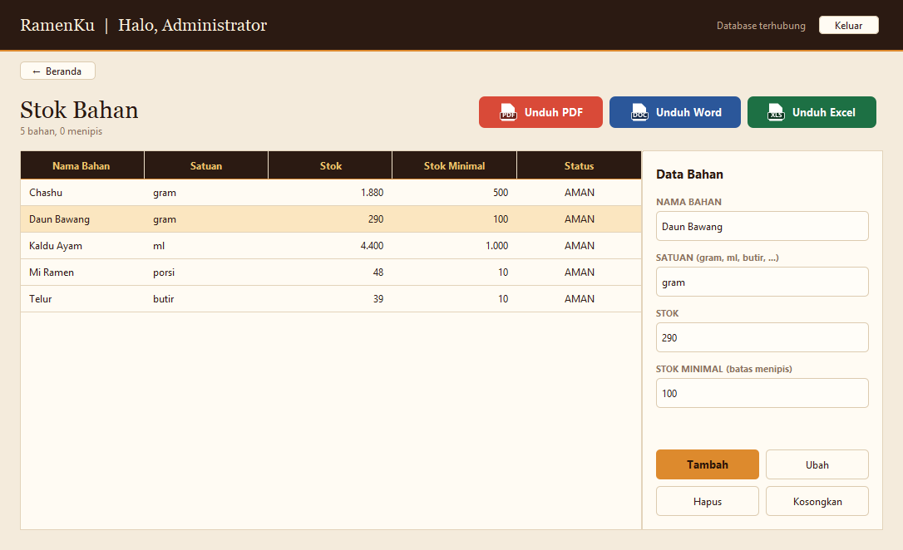<br><sub><b>Stok Bahan</b> dan tombol unduh PDF, Word, Excel</sub></td>
  </tr>
  <tr>
    <td width="50%">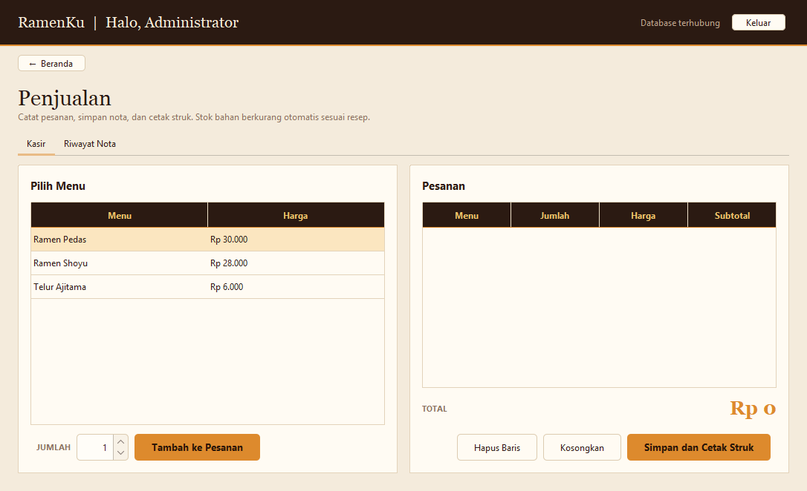<br><sub><b>Penjualan</b>: kasir</sub></td>
    <td width="50%">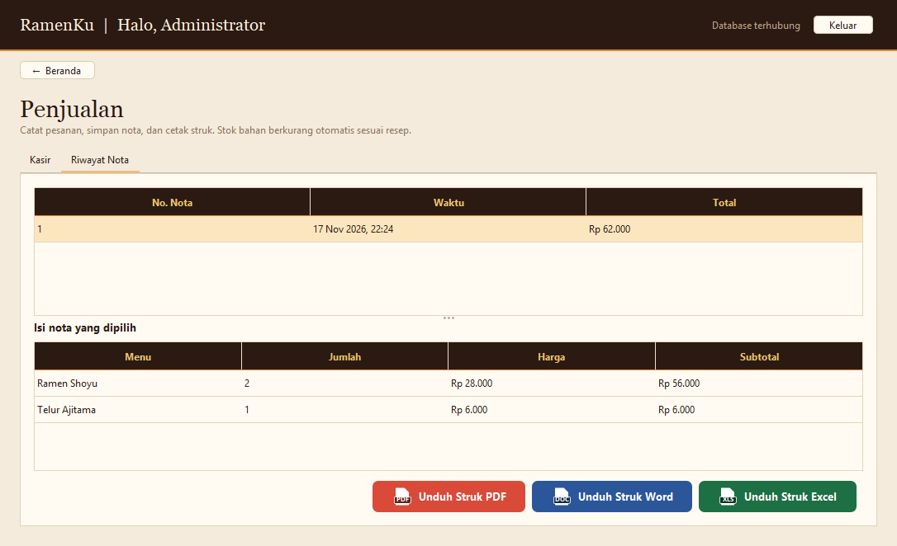<br><sub><b>Riwayat Nota</b> dan unduh struk</sub></td>
  </tr>
  <tr>
    <td width="50%">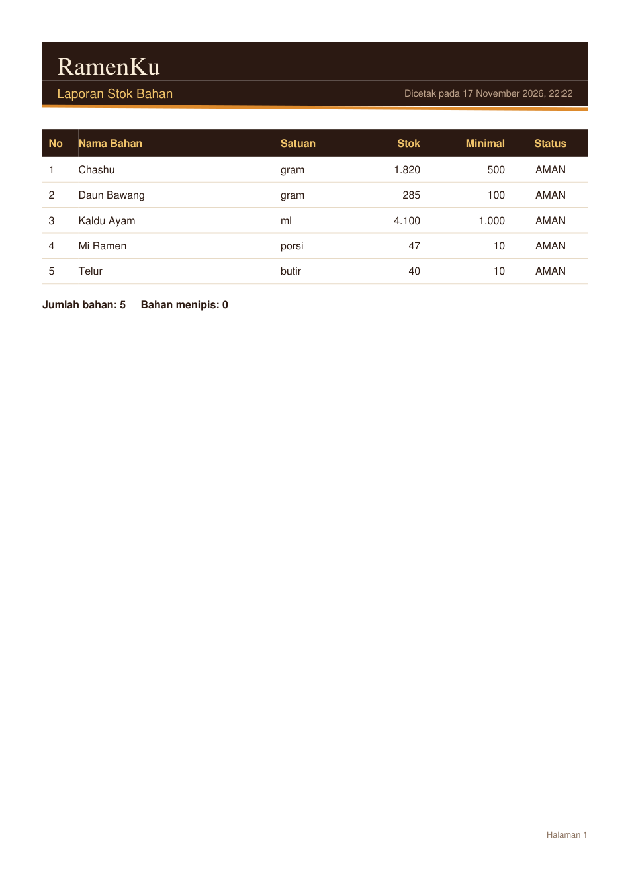<br><sub><b>Laporan stok bahan</b> (PDF)</sub></td>
    <td width="50%">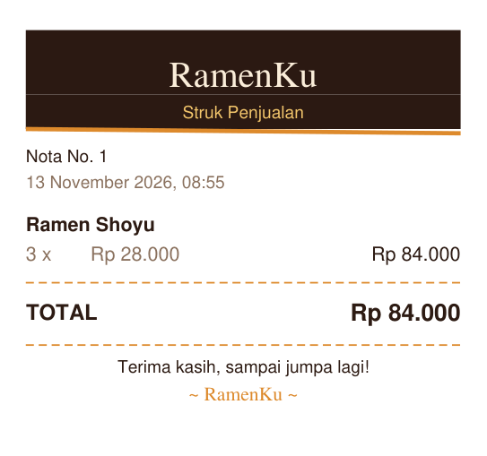<br><sub><b>Struk penjualan</b> (PDF)</sub></td>
  </tr>
</table>

<details>
<summary><b>Tampilan sebelumnya (Pertemuan 3 sampai 5)</b></summary>

<br>

<table>
  <tr>
    <td width="50%">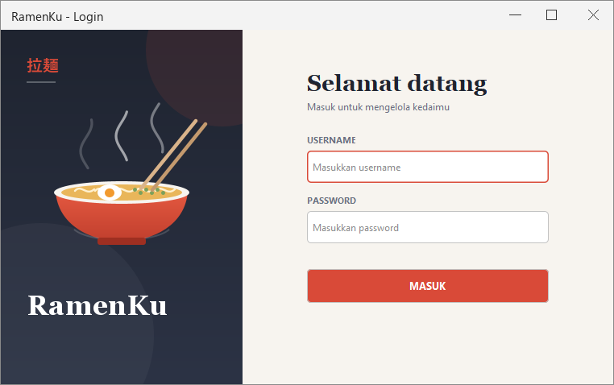<br><sub><b>Login</b> dengan akun terenkripsi SHA-256</sub></td>
    <td width="50%">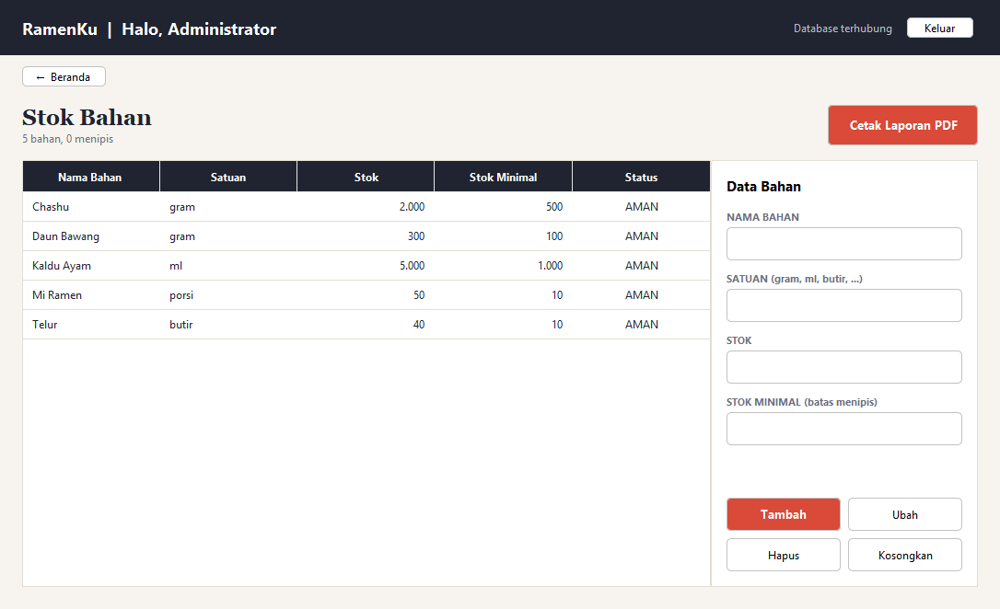<br><sub><b>Stok Bahan</b>: tambah, ubah, hapus, dan penanda menipis</sub></td>
  </tr>
  <tr>
    <td width="50%">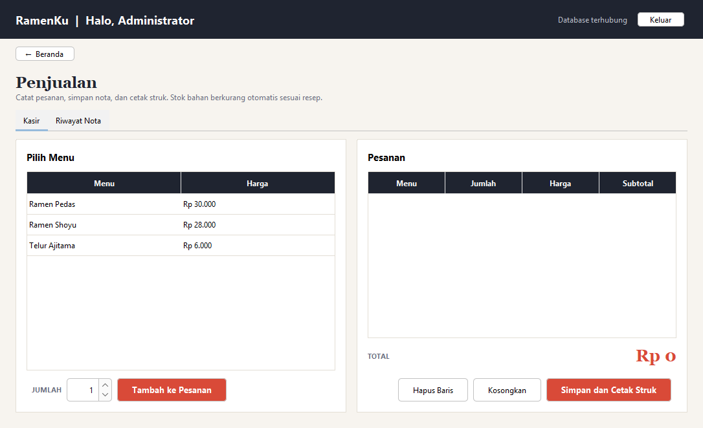<br><sub><b>Penjualan</b>: kasir dan riwayat nota</sub></td>
    <td width="50%">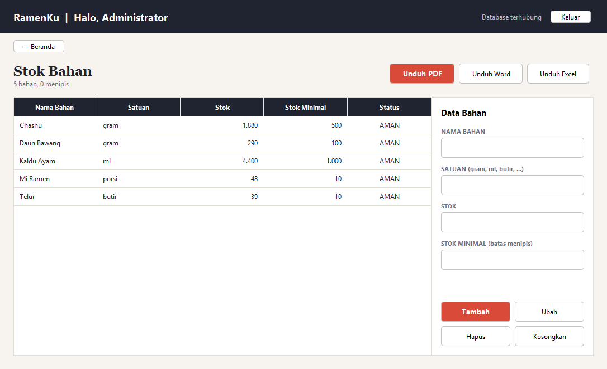<br><sub><b>Unduh laporan</b> sebagai PDF, Word, atau Excel</sub></td>
  </tr>
</table>

</details>

Hasil laporan dan tangkapan layar tiap pertemuan ada di folder `output` masing-masing. Contoh berkas hasil unduhan: [laporan stok dan struk (PDF, Word, Excel)](pertemuan-6/output/contoh-hasil).

## 📁 Struktur repo

```
RamenKu/
├── pertemuan-1/ … pertemuan-8/    materi, LP, TP, kode, LA, dan output tiap pertemuan
│   └── pertemuan-8/               Manual Book RamenKu (Word dan PDF)
├── assets/                        banner pada README ini
├── database/
│   ├── ramenku_db.sql             skema dan data contoh MySQL
│   └── diagram-relasi.png         diagram relasi
├── src/                           proyek RamenKu versi terbaru (Spring + Hibernate)
├── pom.xml                        konfigurasi Maven dan dependensi
├── bangun.bat                     membangun aplikasi
├── jalankan.bat                   menjalankan aplikasi
├── demo-konsol.bat                menjalankan demo konsol OOP
├── koneksi.properties.contoh      contoh pengaturan koneksi MySQL
├── README-OOP.md                  penjelasan konsep OOP (Pertemuan 2)
├── LICENSE                        lisensi MIT
└── README.md
```

## 🗄️ Struktur database

Database `ramenku_db` (MySQL) terdiri dari 6 tabel. Skema lengkapnya ada di [`database/ramenku_db.sql`](database/ramenku_db.sql). Tampilan struktur, relasi, dan isi tiap tabel dari phpMyAdmin ada di [output Pertemuan 3](pertemuan-3/output).

| Tabel | Fungsi | Kolom |
|---|---|---|
| `pengguna` | akun untuk login | id, username, sandi (hash SHA-256), nama |
| `bahan` | stok bahan baku | id, nama, satuan, stok, stok_minimal |
| `menu` | daftar menu dan harganya | id, nama, harga |
| `resep` | bahan yang dipakai per porsi tiap menu | id, menu_id (ke `menu`), bahan_id (ke `bahan`), jumlah |
| `penjualan` | nota penjualan | id, waktu, total |
| `penjualan_item` | isi tiap nota | id, penjualan_id (ke `penjualan`), menu_id (ke `menu`), jumlah, harga_satuan |

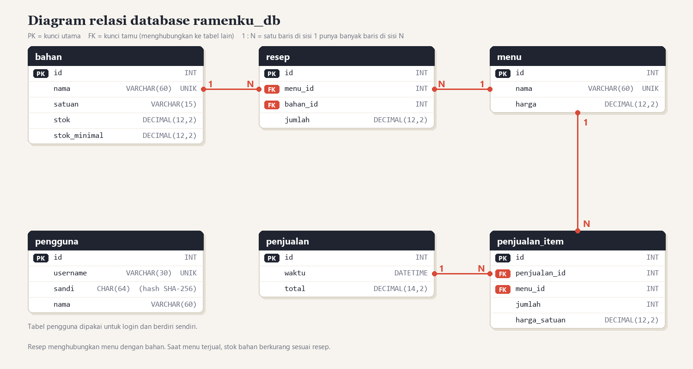

## 🧩 Susunan kode

```
src/
├── main/
│   ├── java/id/ramenku/
│   │   ├── Main.java                aplikasi utama (login lalu menu)
│   │   ├── LoginForm.java           halaman login
│   │   ├── JendelaUtama.java        jendela utama dan menu
│   │   ├── PanelMerek.java          panel merek dengan gambar mangkuk ramen
│   │   ├── Koneksi.java             pengaturan koneksi MySQL
│   │   ├── Pengguna.java            entitas login
│   │   ├── Angka.java               pembaca angka dari input
│   │   ├── data/                    entitas Hibernate dan DAO @Repository yang dikelola Spring
│   │   ├── spring/                  konfigurasi Spring, konteks, dan aspek AOP
│   │   ├── ui/                      halaman Stok Bahan, Menu dan Resep, Penjualan
│   │   ├── laporan/
│   │   │   └── Laporan.java         pembuat laporan PDF, Word, dan Excel dengan JasperReports
│   │   └── oop/                     kode OOP Pertemuan 2
│   │       ├── model/               Produk, MenuMakanan, MenuMinuman, Pesanan
│   │       ├── ui/                  jendela OOP
│   │       └── DemoKonsol.java      demo konsol
│   └── resources/laporan/
│       ├── stok_bahan.jrxml         desain laporan stok bahan
│       └── struk.jrxml              desain struk penjualan
└── test/java/id/ramenku/            tes JUnit (21 tes)
    ├── AngkaTest.java
    ├── data/DataTest.java           DAO Spring dan Hibernate ke MySQL
    └── oop/KonsepOopTest.java
```

## ▶️ Cara menjalankan

1. Nyalakan **MySQL** di XAMPP.
2. Impor `database/ramenku_db.sql` sekali (phpMyAdmin tab Import, atau `mysql -u root < database/ramenku_db.sql`).
3. Klik ganda `bangun.bat`, lalu `jalankan.bat`. Masuk dengan username `admin`; sandi contohnya ada di baris paling bawah `database/ramenku_db.sql`.
   - Di NetBeans 17: File, Open Project, pilih folder `RamenKu`, klik kanan proyek, Run.
   - Demo konsol OOP: `demo-konsol.bat`.

Pengaturan koneksi bawaan XAMPP (localhost:3306, user `root`, tanpa sandi). Untuk mengubahnya, salin
`koneksi.properties.contoh` menjadi `koneksi.properties` (berkas ini tidak ikut ke GitHub).

## 🧪 Pengujian

`mvn test` menjalankan **21 tes otomatis**: konsep OOP, pembacaan angka, serta DAO (Spring dan Hibernate) dan laporan PDF, Word, dan Excel. Tes database memakai database sementara `ramenku_uji` (dibuat lalu dihapus sendiri) dan dilewati bila MySQL tidak menyala.

PDF hasil cetak tersimpan di folder `laporan/` di samping aplikasi (tidak ikut ke GitHub).

## 📘 Manual Book

Manual Book adalah materi Pertemuan 8. Isinya panduan lengkap memasang, memakai, dan memahami RamenKu dari Pertemuan 1 sampai 6: persiapan, panduan tiap fitur, basis data, arsitektur kode, laporan JasperReports, dan Jaspersoft Studio.

| Berkas | Isi |
|---|---|
| [Manual Book V2 (PDF)](pertemuan-8/ManualBook_RamenKu_BimaGunawan_50423276_V2.pdf) | 28 halaman, langsung bisa dibaca di GitHub |
| [Manual Book V2 (Word)](pertemuan-8/ManualBook_RamenKu_BimaGunawan_50423276_V2.docx) | berkas yang bisa diedit |

## 🧰 Merancang laporan di Jaspersoft Studio

Desain laporan (`stok_bahan.jrxml`, `struk.jrxml`) bisa dibuka dan diubah secara visual di Jaspersoft Studio Community 6. Cara memasang, membuka desain, dan alat uji laporan tanpa Studio ada di [pertemuan-6/jaspersoft](pertemuan-6/jaspersoft).

## 📚 Materi, LP, TP, dan Laporan Akhir per pertemuan

Setiap pertemuan punya folder sendiri berisi materi (PPT), soal dan jawaban LP/TP, kode (`kode`), Laporan Akhir (LA), dan gambar output. Karena kodenya berbeda di tiap pertemuan, folder `kode` menyimpan versi proyek pada pertemuan itu, sedangkan folder `src` di akar repo adalah versi terbaru.

<details open>
<summary><b>Daftar berkas per pertemuan</b></summary>

<br>

| # | Materi | PPT | LP | TP | Kode | Laporan Akhir | Output |
|:-:|---|:-:|:-:|:-:|:-:|:-:|:-:|
| 1 | [Rancangan aplikasi ERP](pertemuan-1) | [PPT](pertemuan-1/materi/PPT_Pertemuan1_Desain_Perangkat_Lunak.pptx) | [LP](pertemuan-1/LP/jawaban.md) | [TP](pertemuan-1/TP/jawaban.md) | - | [LA](pertemuan-1/LA/LA1_BimaGunawan_50423276.docx) | - |
| 2 | [OOP Java](pertemuan-2) | [PPT](pertemuan-2/materi/PPT_Pertemuan2_OOP.pdf) | [LP](pertemuan-2/LP/jawaban.md) | [TP](pertemuan-2/TP/jawaban.md) | [kode](pertemuan-2/kode) | [LA](pertemuan-2/LA/LA2_BimaGunawan_50423276.docx) | [output](pertemuan-2/output) |
| 3 | [MVC Java: login dan JDBC](pertemuan-3) | [PPT](pertemuan-3/materi/PPT_Pertemuan3_MVC.pdf) | [LP](pertemuan-3/LP/jawaban.md) | [TP](pertemuan-3/TP/jawaban.md) | [kode](pertemuan-3/kode) | [LA](pertemuan-3/LA/LA3_BimaGunawan_50423276.docx) | [output](pertemuan-3/output) |
| 4 | [ORM Java](pertemuan-4) | [PPT](pertemuan-4/materi/PPT_Pertemuan4_ORM.pdf) | [LP](pertemuan-4/LP/jawaban.md) | [TP](pertemuan-4/TP/jawaban.md) | [kode](pertemuan-4/kode) | [LA](pertemuan-4/LA/LA4_BimaGunawan_50423276.docx) | [output](pertemuan-4/output) |
| 5 | [Spring Java](pertemuan-5) | [PPT](pertemuan-5/materi/PPT_Pertemuan5_Spring.pdf) | [LP](pertemuan-5/LP/jawaban.md) | [TP](pertemuan-5/TP/jawaban.md) | [kode](pertemuan-5/kode) | [LA](pertemuan-5/LA/LA5_BimaGunawan_50423276.docx) | [output](pertemuan-5/output) |
| 6 | [JasperReports](pertemuan-6) | [PPT](pertemuan-6/materi/PPT_Pertemuan6_JasperReports.pdf) | [LP](pertemuan-6/LP/jawaban.md) | [TP](pertemuan-6/TP/jawaban.md) | [kode](pertemuan-6/kode) | [Makalah](pertemuan-6/makalah) | [output](pertemuan-6/output) |
| 7 | [Menyusul](pertemuan-7) | - | - | - | - | - | - |
| 8 | [Manual Book](pertemuan-8) | - | - | - | - | - | [Manual Book](pertemuan-8) |

</details>

## 📜 Lisensi

Kode sumber proyek ini memakai lisensi MIT (lihat [LICENSE](LICENSE)). Materi PPT dan soal praktikum adalah milik dosen dan asisten laboratorium Universitas Gunadarma dan tidak termasuk dalam lisensi tersebut; berkas itu disertakan hanya sebagai arsip belajar.
