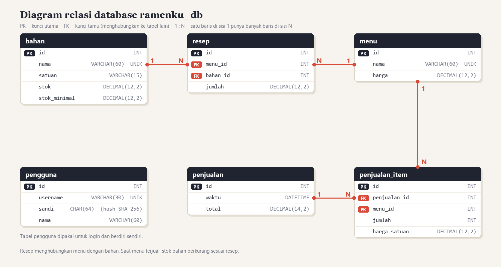

# 🍜 RamenKu

Disusun oleh **Bima Gunawan**, NPM 50423276, kelas 4IA24 (Praktikum Rekayasa Perangkat Lunak 2).

Aplikasi desktop (Java Swing) untuk kedai ramen, dikerjakan bertahap per pertemuan praktikum RPL2.
Satu proyek yang terus bertambah: **JDBC ke MySQL** (Pertemuan 3), **Hibernate** sebagai ORM (Pertemuan 4), lalu **Spring** yang mengelola Hibernate lewat DAO (Pertemuan 5).

## 🪜 Tahapan

| Pertemuan | Isi | Di mana |
|---|---|---|
| 1 | Rancangan aplikasi kedai ramen (berupa dokumen, belum ada kode) | dokumen di folder [pertemuan-1](pertemuan-1) |
| 2 | **OOP**: Encapsulation, Inheritance, Polymorphism | paket `id.ramenku.oop` (lihat [README-OOP.md](README-OOP.md)) |
| 3 | **Login**, tiga fitur (**Menu dan Resep**, **Stok Bahan**, **Penjualan**) dengan **JDBC ke MySQL**, dan laporan **JasperReports** (laporan stok dan struk, PDF) | paket `id.ramenku`, `id.ramenku.data`, `id.ramenku.ui`, `id.ramenku.laporan`; basis data `ramenku_db` |
| 4 | **Hibernate (ORM)**: lapisan data dipindah dari JDBC ke Hibernate (entitas, HQL, transaksi) | paket `id.ramenku.data` (entitas, DAO, `HibernateUtil`) |
| 5 | **Spring Java**: Spring mengelola Hibernate lewat DAO (Dependency Injection, transaksi deklaratif, dan AOP) | paket `id.ramenku.spring` (konfigurasi, konteks, aspek) dan DAO `@Repository` di `id.ramenku.data` |
| 6 | **JasperReports**: laporan stok dan struk diunduh sebagai PDF, Word, dan Excel | `Laporan.Format` dan tombol unduh pada halaman Stok Bahan dan Riwayat Nota |
| 7 | Menyusul (materi belum dibahas) | akan diisi setelah pertemuan berlangsung |
| 8 | **Ujian** praktikum | - |

## 📁 Struktur repo

```
pertemuan-1 .. pertemuan-4/   materi, LP, TP, kode, LA, dan output tiap pertemuan
src/, pom.xml, database/      proyek RamenKu versi terbaru (Spring + Hibernate)
README-OOP.md                 penjelasan konsep OOP (Pertemuan 2)
bangun.bat, jalankan.bat,     skrip membangun dan menjalankan aplikasi
demo-konsol.bat
koneksi.properties.contoh     contoh pengaturan koneksi MySQL
```

## 📅 Jadwal pertemuan

Praktikum Rekayasa Perangkat Lunak 2 berlangsung setiap hari Jumat pagi.

| Pertemuan | Tanggal | Materi | Tugas |
|---|---|---|---|
| 1 | Jumat, 16 Oktober 2026 | Rancangan aplikasi ERP | LP 1, TP 1, LA 1 |
| 2 | Jumat, 23 Oktober 2026 | OOP Java | LP 2, TP 2, LA 2 |
| 3 | Jumat, 30 Oktober 2026 | MVC Java: login dan JDBC | LP 3, TP 3, LA 3 |
| 4 | Jumat, 6 November 2026 | ORM Java: Hibernate | LP 4, TP 4, LA 4 |
| 5 | Jumat, 13 November 2026 | Spring Java | LP 5, TP 5, LA 5 |
| 6 | Jumat, 20 November 2026 | JasperReports (PDF, Word, Excel) | - |
| 7 | Jumat, 27 November 2026 | Menyusul | - |
| 8 | Jumat, 4 Desember 2026 | Ujian | - |

## 📚 Materi, LP, TP, dan Laporan Akhir per pertemuan

Setiap pertemuan punya folder sendiri berisi materi (PPT), soal dan jawaban LP/TP, kode (`kode`), Laporan Akhir (LA), dan gambar output. Karena kodenya berbeda di tiap pertemuan, folder `kode` menyimpan versi proyek pada pertemuan itu, sedangkan folder `src` di akar repo adalah versi terbaru. Gambar output ada di folder `output` tiap pertemuan.

| Pertemuan | Materi | PPT | LP | TP | Kode | Laporan Akhir | Output |
|---|---|---|---|---|---|---|---|
| 1 | Rancangan aplikasi ERP | [PPT](pertemuan-1/materi/PPT_Pertemuan1_Desain_Perangkat_Lunak.pptx) | [LP](pertemuan-1/LP/jawaban.md) | [TP](pertemuan-1/TP/jawaban.md) | - | [LA](pertemuan-1/LA/LA1_BimaGunawan_50423276.docx) | dokumen rancangan, tanpa tampilan program |
| 2 | OOP Java | [PPT](pertemuan-2/materi/PPT_Pertemuan2_OOP.pdf) | [LP](pertemuan-2/LP/jawaban.md) | [TP](pertemuan-2/TP/jawaban.md) | [kode](pertemuan-2/kode) | [LA](pertemuan-2/LA/LA2_BimaGunawan_50423276.docx) | [lihat output](pertemuan-2/output) |
| 3 | MVC Java: login dan JDBC | [PPT](pertemuan-3/materi/PPT_Pertemuan3_MVC.pdf) | [LP](pertemuan-3/LP/jawaban.md) | [TP](pertemuan-3/TP/jawaban.md) | [kode](pertemuan-3/kode) | [LA](pertemuan-3/LA/LA3_BimaGunawan_50423276.docx) | [lihat output](pertemuan-3/output) |
| 4 | ORM Java | [PPT](pertemuan-4/materi/PPT_Pertemuan4_ORM.pdf) | [LP](pertemuan-4/LP/jawaban.md) | [TP](pertemuan-4/TP/jawaban.md) | [kode](pertemuan-4/kode) | [LA](pertemuan-4/LA/LA4_BimaGunawan_50423276.docx) | [lihat output](pertemuan-4/output) |
| 5 | [Spring Java](pertemuan-5) | [PPT](pertemuan-5/materi/PPT_Pertemuan5_Spring.pdf) | [LP](pertemuan-5/LP/jawaban.md) | [TP](pertemuan-5/TP/jawaban.md) | [kode](pertemuan-5/kode) | [LA 5](pertemuan-5/LA/LA5_BimaGunawan_50423276.docx) | [lihat output](pertemuan-5/output) |
| 6 | [JasperReports](pertemuan-6) | - | - | - | [kode](pertemuan-6/kode) | - | [lihat output](pertemuan-6/output) |
| 7 | [Menyusul](pertemuan-7) | - | - | - | - | - | - |
| 8 | [Ujian](pertemuan-8) | - | - | - | - | - | - |

## 🗄️ Struktur database

Database `ramenku_db` (MySQL) terdiri dari 6 tabel. Skema lengkapnya ada di [`database/ramenku_db.sql`](database/ramenku_db.sql). Tampilan struktur, relasi, dan isi tiap tabel dari phpMyAdmin ada di [output Pertemuan 3](pertemuan-3/output).

| Tabel | Fungsi | Kolom |
|---|---|---|
| `pengguna` | akun untuk login | id, username, sandi (hash SHA-256), nama |
| `bahan` | stok bahan baku | id, nama, satuan, stok, stok_minimal |
| `menu` | daftar menu dan harganya | id, nama, harga |
| `resep` | bahan yang dipakai per porsi tiap menu | id, menu_id (ke `menu`), bahan_id (ke `bahan`), jumlah |
| `penjualan` | nota penjualan | id, waktu, total |
| `penjualan_item` | isi tiap nota | id, penjualan_id (ke `penjualan`), menu_id (ke `menu`), jumlah, harga_satuan |



## 🧩 Susunan kode

```
src/main/java/id/ramenku/
  Main.java, LoginForm.java, JendelaUtama.java   aplikasi utama (login lalu menu)
  Koneksi.java, Pengguna.java                    pengaturan koneksi MySQL, entitas login
  data/                                          entitas Hibernate dan DAO @Repository yang dikelola Spring
  spring/                                        konfigurasi Spring, konteks, dan aspek AOP
  ui/                                            halaman Stok Bahan, Menu dan Resep, Penjualan
  laporan/Laporan.java                           pembuat laporan PDF, Word, dan Excel dengan JasperReports
  oop/                                           kode OOP pertemuan 2 (model, ui, demo konsol)
src/main/resources/laporan/                      desain laporan (stok_bahan.jrxml, struk.jrxml)
src/test/java/                                   tes JUnit (OOP, angka, DAO Spring dan Hibernate ke MySQL)
database/ramenku_db.sql, diagram-relasi.png      skema, data contoh, dan diagram relasi MySQL
```

## ▶️ Cara menjalankan

1. Nyalakan **MySQL** di XAMPP.
2. Impor `database/ramenku_db.sql` sekali (phpMyAdmin tab Import, atau `mysql -u root < database/ramenku_db.sql`).
3. Klik ganda `bangun.bat`, lalu `jalankan.bat`. Masuk dengan username `admin`; sandi contohnya ada di baris paling bawah `database/ramenku_db.sql`.
   - Di NetBeans 17: File, Open Project, pilih folder `RamenKu`, klik kanan proyek, Run.
   - Demo konsol OOP: `demo-konsol.bat`.

Pengaturan koneksi bawaan XAMPP (localhost:3306, user `root`, tanpa sandi). Untuk mengubahnya, salin
`koneksi.properties.contoh` menjadi `koneksi.properties` (berkas ini tidak ikut ke GitHub).

## 🧪 Pengujian

`mvn test` menjalankan 21 tes otomatis: konsep OOP, pembacaan angka, serta DAO (Spring dan Hibernate) dan laporan PDF, Word, dan Excel. Tes database memakai
database sementara `ramenku_uji` (dibuat lalu dihapus sendiri) dan dilewati bila MySQL tidak menyala.

PDF hasil cetak tersimpan di folder `laporan/` di samping aplikasi (tidak ikut ke GitHub).

## 📜 Lisensi

Kode sumber proyek ini memakai lisensi MIT (lihat [LICENSE](LICENSE)). Materi PPT dan soal praktikum adalah milik dosen dan asisten laboratorium Universitas Gunadarma dan tidak termasuk dalam lisensi tersebut; berkas itu disertakan hanya sebagai arsip belajar.
