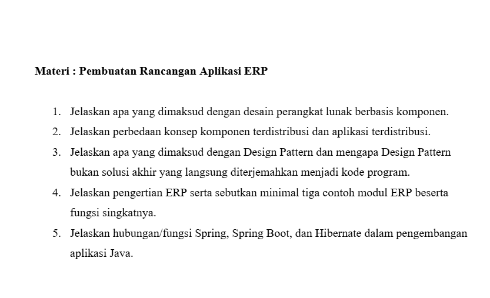

# LP 1: Pembuatan Rancangan Aplikasi ERP

Mata praktikum Rekayasa Perangkat Lunak 2, Pertemuan 1. Jawaban oleh Bima Gunawan (NPM 50423276, 4IA24).

## Soal

## Jawaban

**Materi: Pembuatan Rancangan Aplikasi ERP**

**1. Jelaskan apa yang dimaksud dengan desain perangkat lunak berbasis komponen.**

Jawab:
Desain perangkat lunak berbasis komponen adalah perancangan yang membagi sistem menjadi komponen-komponen mandiri yang dapat digunakan kembali dan berinteraksi melalui antarmuka (*interface*).

**2. Jelaskan perbedaan konsep komponen terdistribusi dan aplikasi terdistribusi.**

Jawab:
Komponen terdistribusi adalah modul perangkat lunak yang ditempatkan pada komputer berbeda dan dipanggil melalui jaringan. Aplikasi terdistribusi adalah sistem secara keseluruhan yang berjalan pada beberapa komputer yang saling terhubung.

**3. Jelaskan apa yang dimaksud dengan Design Pattern dan mengapa Design Pattern bukan solusi akhir yang langsung diterjemahkan menjadi kode program.**

Jawab:
*Design Pattern* adalah solusi umum yang telah teruji untuk masalah perancangan perangkat lunak yang sering berulang. Pola ini bukan solusi akhir karena hanya berupa panduan konsep, sehingga harus disesuaikan dengan kebutuhan sistem dan bahasa pemrograman.

**4. Jelaskan pengertian ERP serta sebutkan minimal tiga contoh modul ERP beserta fungsi singkatnya.**

Jawab:
*Enterprise Resource Planning* (ERP) adalah sistem informasi terpadu yang mengintegrasikan seluruh proses bisnis perusahaan dalam satu basis data.

Contoh modul:
1. Keuangan: mencatat transaksi dan menyusun laporan keuangan.
2. Penjualan: mengelola pesanan dan faktur.
3. Persediaan: memantau stok barang.

**5. Jelaskan hubungan/fungsi Spring, Spring Boot, dan Hibernate dalam pengembangan aplikasi Java.**

Jawab:
*Spring* adalah *framework* Java yang mengatur objek dan ketergantungan antarkomponen. *Spring Boot* menyederhanakan konfigurasi *Spring*. *Hibernate* adalah *framework* ORM yang memetakan kelas Java ke tabel basis data.

[Kembali ke Pertemuan 1](../README.md)
