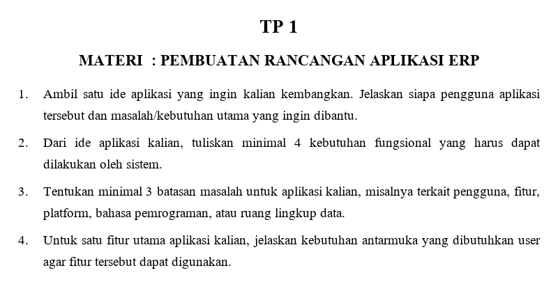

# TP 1: Pembuatan Rancangan Aplikasi ERP

Mata praktikum Rekayasa Perangkat Lunak 2, Pertemuan 1. Jawaban oleh Bima Gunawan (NPM 50423276, 4IA24).

## Soal

## Jawaban

**1. Ambil satu ide aplikasi yang ingin kalian kembangkan. Jelaskan siapa pengguna aplikasi tersebut dan masalah/kebutuhan utama yang ingin dibantu.**

Jawab:
JadwalKu adalah aplikasi pengingat tugas dan jadwal untuk mahasiswa. Penggunanya adalah mahasiswa. Masalah utamanya adalah mahasiswa sering lupa tenggat tugas dan kesulitan membagi waktu antara kuliah, tugas, dan organisasi.

**2. Dari ide aplikasi kalian, tuliskan minimal 4 kebutuhan fungsional yang harus dapat dilakukan oleh sistem.**

Jawab:
1. Sistem dapat mencatat tugas (judul, mata kuliah, tenggat, dan prioritas).
2. Sistem dapat menampilkan jadwal dan tugas dalam kalender.
3. Sistem dapat mengirim notifikasi pengingat sebelum tenggat.
4. Sistem dapat menandai tugas yang sudah selesai.

**3. Tentukan minimal 3 batasan masalah untuk aplikasi kalian, misalnya terkait pengguna, fitur, platform, bahasa pemrograman, atau ruang lingkup data.**

Jawab:
1. Pengguna hanya mahasiswa, tanpa peran dosen atau admin.
2. Platform hanya Android, dikembangkan menggunakan Flutter.
3. Fitur terbatas pada pencatatan, jadwal, dan pengingat, tanpa kolaborasi kelompok dan tanpa integrasi dengan sistem kampus.

**4. Untuk satu fitur utama aplikasi kalian, jelaskan kebutuhan antarmuka yang dibutuhkan user agar fitur tersebut dapat digunakan.**

Jawab:
Fitur utama yang dipilih adalah pencatatan tugas. Antarmuka yang dibutuhkan adalah formulir input (judul, mata kuliah, tenggat, prioritas) dengan tombol "Simpan", daftar tugas, dan pesan konfirmasi agar pengguna tahu bahwa tugas sudah tersimpan.

[Kembali ke Pertemuan 1](../README.md)
