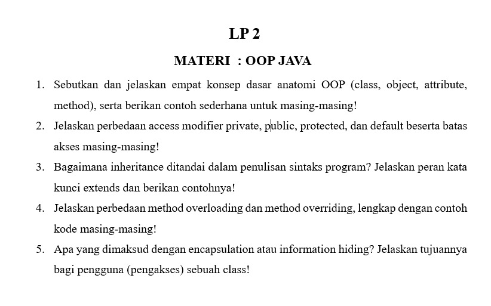

# LP 2: OOP Java

Mata praktikum Rekayasa Perangkat Lunak 2, Pertemuan 2. Jawaban oleh Bima Gunawan (NPM 50423276, 4IA24).

## Soal



## Jawaban

**1. Sebutkan dan jelaskan empat konsep dasar anatomi OOP (class, object, attribute, method), serta berikan contoh sederhana untuk masing-masing!**

Jawab:
- **Class** adalah cetak biru atau templat yang mendefinisikan atribut dan method suatu objek.
  Contoh: `class Mobil { }`
- **Object** adalah wujud nyata (*instance*) dari sebuah class yang dibuat dengan kata kunci `new`.
  Contoh: `Mobil m = new Mobil();`
- **Attribute** adalah data atau properti yang dimiliki class, berupa variabel.
  Contoh: `String warna;`
- **Method** adalah perilaku atau aksi yang dapat dilakukan class, berupa fungsi.
  Contoh: `void jalan() { System.out.println("Mobil berjalan"); }`

**2. Jelaskan perbedaan access modifier private, public, protected, dan default beserta batas akses masing-masing!**

Jawab:
- **private**: hanya dapat diakses di dalam class itu sendiri.
- **default** (tanpa kata kunci): dapat diakses oleh class lain dalam paket (*package*) yang sama.
- **protected**: dapat diakses dalam paket yang sama dan oleh *subclass*, meskipun berbeda paket.
- **public**: dapat diakses dari class mana pun.

Urutan dari yang paling terbuka: public, protected, default, private.

**3. Bagaimana inheritance ditandai dalam penulisan sintaks program? Jelaskan peran kata kunci extends dan berikan contohnya!**

Jawab:
*Inheritance* (pewarisan) ditandai dengan kata kunci **extends** pada deklarasi class. Kata kunci ini menghubungkan *subclass* (class turunan) dengan *superclass* (class induk), sehingga subclass mewarisi atribut dan method superclass yang tidak bersifat private.

```java
class Hewan {
    void makan() { System.out.println("Hewan makan"); }
}
class Kucing extends Hewan {
    void mengeong() { System.out.println("Meong"); }
}
```
Objek `Kucing` dapat memanggil `makan()` karena diwarisi dari `Hewan`. Java hanya mengizinkan satu superclass untuk tiap class.

**4. Jelaskan perbedaan method overloading dan method overriding, lengkap dengan contoh kode masing-masing!**

Jawab:
- **Overloading**: beberapa method dengan nama sama dalam satu class, tetapi daftar parameternya berbeda (jumlah atau tipe).
- **Overriding**: subclass mendefinisikan ulang method milik superclass dengan nama dan parameter yang sama.

Contoh overloading:
```java
class Kalkulator {
    int tambah(int a, int b) { return a + b; }
    double tambah(double a, double b) { return a + b; }
}
```
Contoh overriding:
```java
class Hewan {
    void suara() { System.out.println("Hewan bersuara"); }
}
class Kucing extends Hewan {
    @Override
    void suara() { System.out.println("Meong"); }
}
```

**5. Apa yang dimaksud dengan encapsulation atau information hiding? Jelaskan tujuannya bagi pengguna (pengakses) sebuah class!**

Jawab:
*Encapsulation* adalah teknik membungkus atribut dan method dalam satu class, dengan menyembunyikan atribut memakai **private** dan menyediakan akses melalui method **getter** dan **setter** yang *public*.

```java
class Rekening {
    private double saldo;
    public double getSaldo() { return saldo; }
    public void setSaldo(double saldo) {
        if (saldo >= 0) this.saldo = saldo;
    }
}
```
Tujuannya bagi pengakses class: data terlindungi dari perubahan sembarangan karena harus melalui validasi, pengguna cukup memakai method tanpa perlu mengetahui cara kerja di dalamnya, dan perubahan isi class tidak merusak kode pengguna.

[Kembali ke Pertemuan 2](../README.md)
