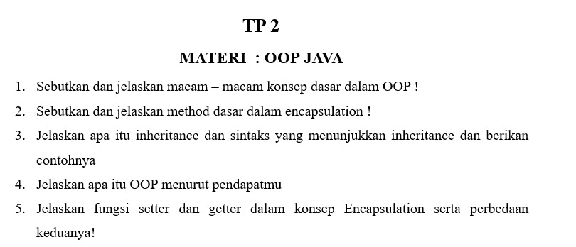

# TP 2: OOP Java

Mata praktikum Rekayasa Perangkat Lunak 2, Pertemuan 2. Jawaban oleh Bima Gunawan (NPM 50423276, 4IA24).

## Soal



## Jawaban

**1. Sebutkan dan jelaskan macam-macam konsep dasar dalam OOP!**

Jawab:
Konsep dasar OOP terdiri atas empat pilar:
1. **Encapsulation** adalah pembungkusan data (atribut) dan method dalam satu class, dengan menyembunyikan atribut agar hanya dapat diakses lewat method tertentu.
2. **Inheritance** adalah pewarisan, yaitu class turunan (*subclass*) mewarisi atribut dan method dari class induk (*superclass*).
3. **Polymorphism** adalah kemampuan satu method atau objek memiliki banyak bentuk, misalnya melalui *overloading* dan *overriding*.
4. **Abstraction** adalah penyederhanaan dengan menampilkan hal yang penting saja dan menyembunyikan detail implementasi, misalnya lewat *abstract class* dan *interface*.

**2. Sebutkan dan jelaskan method dasar dalam encapsulation!**

Jawab:
Method dasar dalam *encapsulation* ada dua:
1. **Getter**, yaitu method untuk membaca (mengambil) nilai atribut yang bersifat private.
2. **Setter**, yaitu method untuk mengubah (mengisi) nilai atribut yang bersifat private.

**3. Jelaskan apa itu inheritance dan sintaks yang menunjukkan inheritance dan berikan contohnya!**

Jawab:
*Inheritance* (pewarisan) adalah konsep ketika sebuah class (*subclass*) mewarisi atribut dan method dari class lain (*superclass*), sehingga kode dapat dipakai ulang. Sintaks yang menunjukkan inheritance adalah kata kunci **extends**.

```java
class Hewan {
    void makan() { System.out.println("Hewan makan"); }
}
class Kucing extends Hewan {
    void mengeong() { System.out.println("Meong"); }
}
```
Class `Kucing` mewarisi method `makan()` dari class `Hewan`.

**4. Jelaskan apa itu OOP menurut pendapatmu!**

Jawab:
Menurut saya, OOP (*Object Oriented Programming*) adalah cara membuat program dengan memodelkan benda-benda dalam dunia nyata menjadi objek yang memiliki data (atribut) dan perilaku (method). Pendekatan ini membuat program lebih terstruktur, mudah dipahami, kodenya dapat dipakai ulang, dan lebih mudah dipelihara serta dikembangkan dibandingkan menulis program secara berurutan biasa.

**5. Jelaskan fungsi setter dan getter dalam konsep Encapsulation serta perbedaan keduanya!**

Jawab:
*Setter* dan *getter* berfungsi sebagai pintu akses ke atribut private, sehingga data terlindungi dan perubahan nilainya dapat divalidasi.
- **Getter** berfungsi mengambil atau membaca nilai atribut. Method ini mengembalikan nilai (*return*) dan tidak memiliki parameter.
- **Setter** berfungsi mengubah atau mengisi nilai atribut. Method ini memiliki parameter dan umumnya bertipe `void` (tidak mengembalikan nilai), serta dapat disisipi pengecekan nilai.

```java
class Mahasiswa {
    private String nama;
    public String getNama() { return nama; }              // getter
    public void setNama(String nama) { this.nama = nama; } // setter
}
```
Perbedaannya, getter dipakai untuk **membaca** data, sedangkan setter dipakai untuk **menulis** data.

[Kembali ke Pertemuan 2](../README.md)
