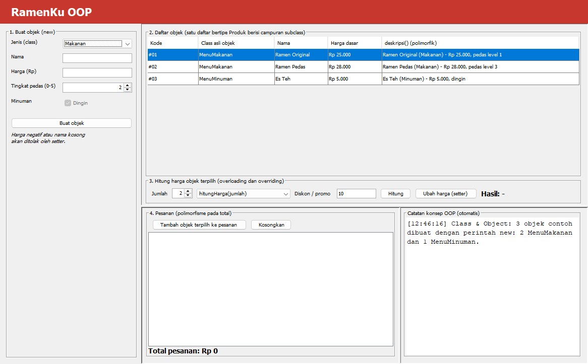
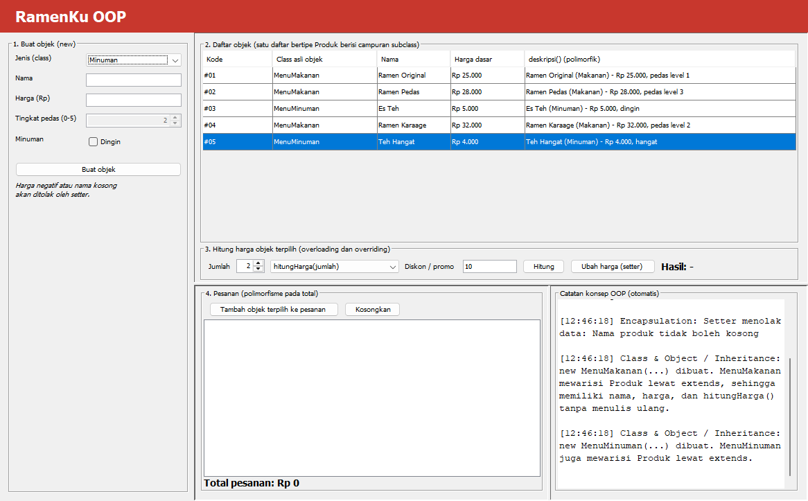
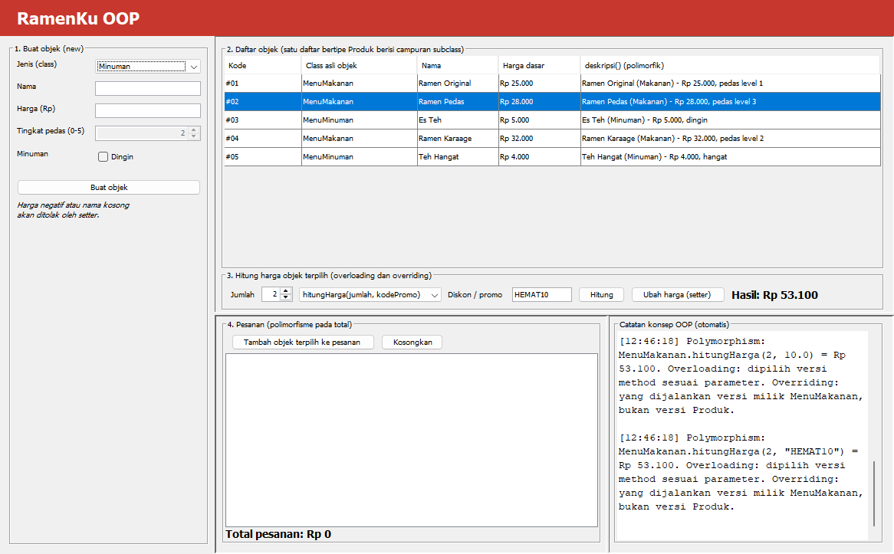
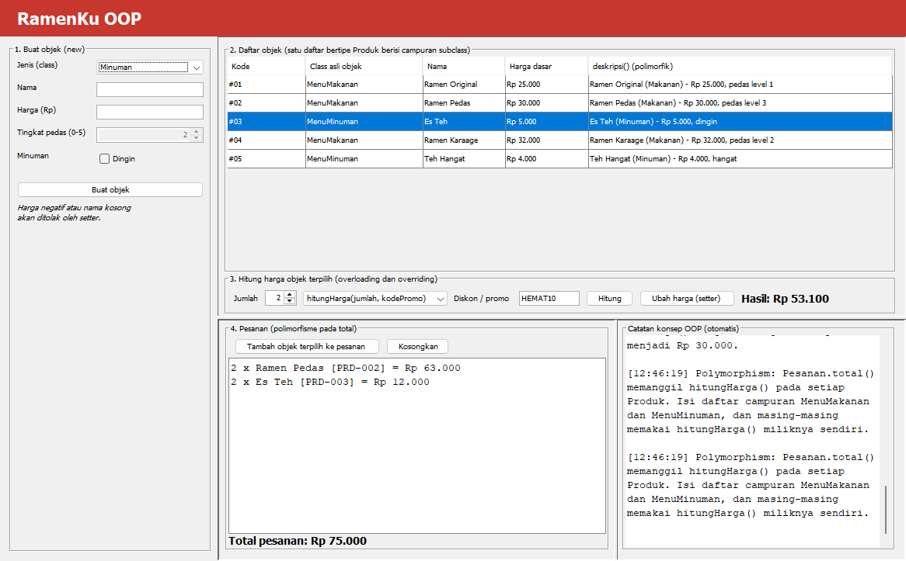
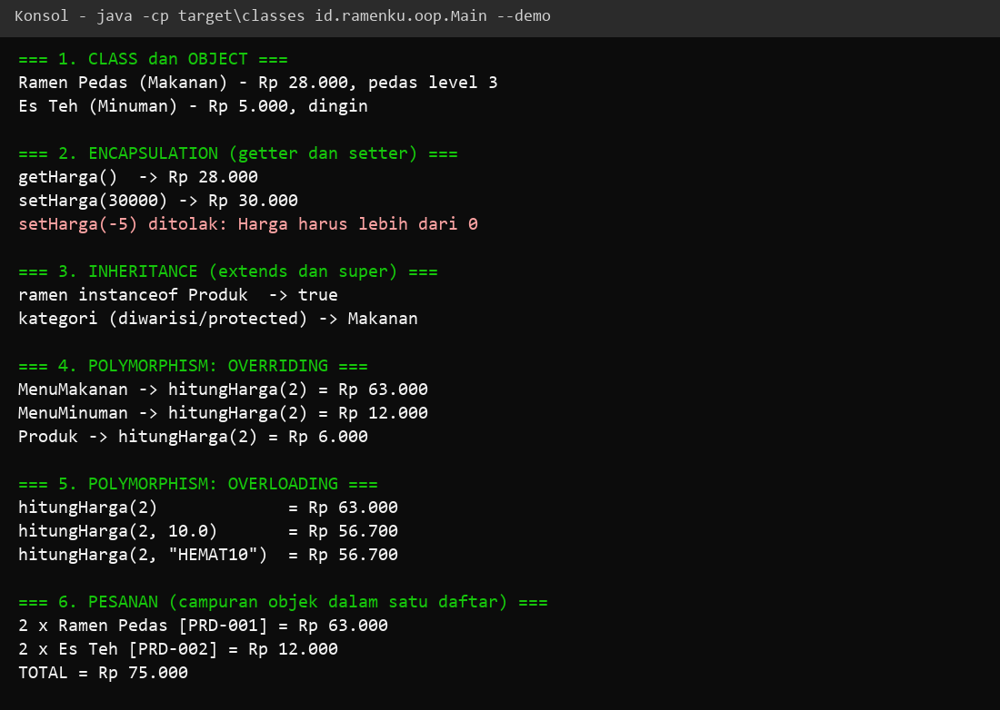
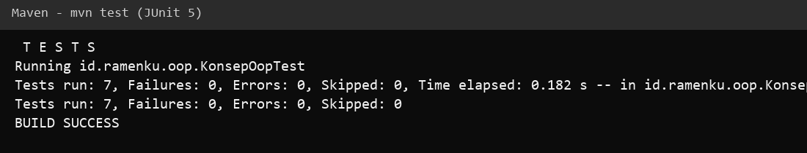

# Output Pertemuan 2: OOP

[Kembali ke Pertemuan 2](../README.md) | [README utama](../../README.md) | [Kode](../kode) | [LP](../LP/jawaban.md) | [TP](../TP/jawaban.md)

**Jendela awal RamenKu OOP**

**Encapsulation (setter menolak harga negatif) dan inheritance (class asli tiap objek)**

**Polymorphism: overriding dan tiga versi overloading hitungHarga**

**Total pesanan dihitung polimorfik dari daftar campuran makanan dan minuman**

**Demo semua konsep OOP di konsol**

**Hasil 7 tes JUnit**

