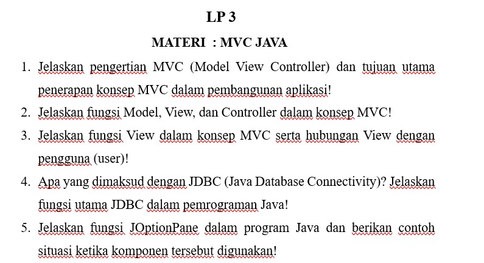

# LP 3: MVC Java

Mata praktikum Rekayasa Perangkat Lunak 2, Pertemuan 3. Jawaban oleh Bima Gunawan (NPM 50423276, 4IA24).

## Soal

## Jawaban

**1. Jelaskan pengertian MVC (Model View Controller) dan tujuan utama penerapan konsep MVC dalam pembangunan aplikasi!**

MVC adalah pola perancangan aplikasi yang membagi program menjadi tiga bagian terpisah, yaitu Model, View, dan Controller. Tujuan utamanya adalah memisahkan data, tampilan, dan logika program. Dengan begitu kode lebih terstruktur, mudah dirawat, mudah dikembangkan, dan setiap bagian dapat digunakan kembali.

**2. Jelaskan fungsi Model, View, dan Controller dalam konsep MVC!**

- **Model** mengelola data dan aturan bisnis aplikasi, termasuk berhubungan dengan basis data.
- **View** menampilkan data kepada pengguna dalam bentuk antarmuka.
- **Controller** menerima masukan dari pengguna, memprosesnya, lalu menghubungkan Model dan View.

**3. Jelaskan fungsi View dalam konsep MVC serta hubungan View dengan pengguna (user)!**

View berfungsi menampilkan data dari Model dalam bentuk antarmuka yang dapat dilihat pengguna, seperti form, tabel, dan tombol. View tidak memuat logika pengolahan data. Hubungannya dengan pengguna adalah sebagai perantara: pengguna memberi masukan melalui View, lalu hasil prosesnya ditampilkan kembali lewat View.

**4. Apa yang dimaksud dengan JDBC (Java Database Connectivity)? Jelaskan fungsi utama JDBC dalam pemrograman Java!**

JDBC adalah API Java yang digunakan untuk menghubungkan program Java dengan basis data. Fungsi utamanya adalah membuka koneksi ke basis data, mengirim perintah SQL (seperti SELECT, INSERT, UPDATE, DELETE), dan mengambil hasilnya untuk diolah di program.

**5. Jelaskan fungsi JOptionPane dalam program Java dan berikan contoh situasi ketika komponen tersebut digunakan!**

JOptionPane adalah komponen Swing untuk menampilkan kotak dialog standar. Fungsinya menampilkan pesan, meminta konfirmasi, atau meminta input singkat dari pengguna. Contoh situasinya: menampilkan pesan "Data berhasil disimpan" setelah menyimpan data, atau menampilkan konfirmasi "Yakin ingin menghapus data?" sebelum data dihapus.

[Kembali ke Pertemuan 3](../README.md)
