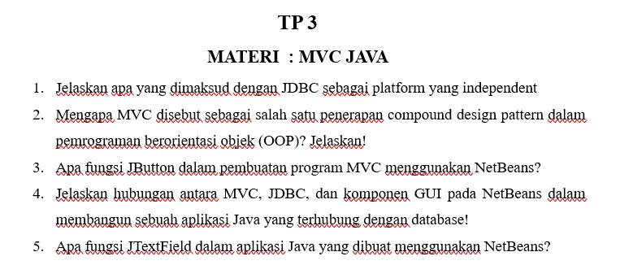

# TP 3: MVC Java

Mata praktikum Rekayasa Perangkat Lunak 2, Pertemuan 3. Jawaban oleh Bima Gunawan (NPM 50423276, 4IA24).

## Soal

## Jawaban

**1. Jelaskan apa yang dimaksud dengan JDBC sebagai platform yang independen!**
JDBC adalah API Java untuk menghubungkan program dengan basis data. Disebut independen karena tidak terikat pada satu sistem operasi atau satu jenis basis data. Untuk berganti basis data cukup mengganti driver dan URL koneksi.

**2. Mengapa MVC disebut sebagai salah satu penerapan compound design pattern dalam OOP? Jelaskan!**
Karena MVC menggabungkan beberapa pola desain dalam satu rancangan, yaitu Observer, Strategy, dan Composite. Gabungan itu membuat Model, View, dan Controller dapat bekerja sama namun tetap terpisah.

**3. Apa fungsi JButton dalam pembuatan program MVC menggunakan NetBeans?**
JButton adalah tombol pada View yang menerima klik pengguna, misalnya Simpan atau Hapus. Klik itu memicu event yang diproses oleh Controller.

**4. Jelaskan hubungan antara MVC, JDBC, dan komponen GUI pada NetBeans dalam membangun aplikasi Java yang terhubung dengan database!**
Komponen GUI menjadi View yang dilihat pengguna. Controller menerima aksi dari GUI, lalu Model memakai JDBC untuk mengakses database. Hasilnya dikembalikan lewat Controller untuk ditampilkan di View.

**5. Apa fungsi JTextField dalam aplikasi Java yang dibuat menggunakan NetBeans?**
JTextField adalah kolom isian satu baris untuk menerima masukan teks dari pengguna, seperti nama atau harga. Isinya diambil dengan `getText()` untuk diproses dan disimpan ke database.

[Kembali ke Pertemuan 3](../README.md)
