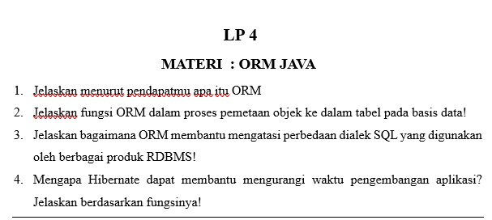

# LP 4: ORM Java

Mata praktikum Rekayasa Perangkat Lunak 2, Pertemuan 4. Jawaban oleh Bima Gunawan (NPM 50423276, 4IA24).

## Soal

## Jawaban

**1. Jelaskan menurut pendapatmu apa itu ORM**
ORM (_Object Relational Mapping_) adalah teknik yang menghubungkan objek di program Java dengan tabel di basis data. Dengan ORM, data diambil dan disimpan lewat objek, sehingga kita tidak perlu menulis banyak perintah SQL sendiri. Menurutku ORM membuat program lebih rapi dan lebih cepat dikerjakan.

**2. Jelaskan fungsi ORM dalam proses pemetaan objek ke dalam tabel pada basis data!**
ORM memetakan _class_ menjadi tabel, atribut menjadi kolom, dan objek menjadi satu baris data. Saat objek disimpan, ORM otomatis membuat perintah **INSERT**, dan saat objek diubah atau dihapus, ORM membuat perintah **UPDATE** atau **DELETE**. Begitu juga sebaliknya, hasil **SELECT** diubah ORM menjadi objek Java.

**3. Jelaskan bagaimana ORM membantu mengatasi perbedaan dialek SQL yang digunakan oleh berbagai produk RDBMS!**
Setiap RDBMS punya dialek SQL yang sedikit berbeda. ORM menerjemahkan objek menjadi SQL yang sesuai dengan database yang dipakai, sehingga untuk berpindah database cukup mengganti pengaturan dialek tanpa menulis ulang kode.

**4. Mengapa Hibernate dapat membantu mengurangi waktu pengembangan aplikasi? Jelaskan berdasarkan fungsinya!**
Hibernate membuat perintah SQL dan mengubah hasilnya menjadi objek secara otomatis. Programmer tidak perlu menulis kode JDBC yang panjang dan berulang, sehingga kode lebih sedikit dan waktu pengembangan lebih singkat.

[Kembali ke Pertemuan 4](../README.md)
