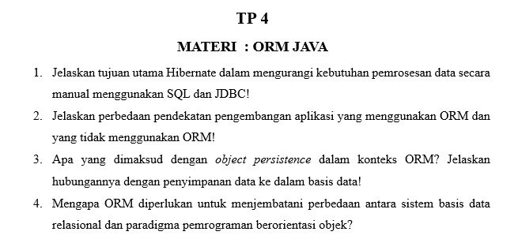

# TP 4: ORM Java

Mata praktikum Rekayasa Perangkat Lunak 2, Pertemuan 4. Jawaban oleh Bima Gunawan (NPM 50423276, 4IA24).

## Soal

## Jawaban

**1. Jelaskan tujuan utama Hibernate dalam mengurangi kebutuhan pemrosesan data secara manual menggunakan SQL dan JDBC!**
Hibernate membuat SQL dan mengubah hasil query menjadi objek secara otomatis, sehingga kode JDBC yang panjang tidak perlu ditulis manual.

**2. Jelaskan perbedaan pendekatan pengembangan aplikasi yang menggunakan ORM dan yang tidak menggunakan ORM!**
Tanpa ORM, SQL dan JDBC ditulis manual sehingga kode panjang. Dengan ORM, data dikelola lewat objek dan SQL dibuat otomatis sehingga kode lebih singkat.

**3. Apa yang dimaksud dengan _object persistence_ dalam konteks ORM? Jelaskan hubungannya dengan penyimpanan data ke dalam basis data!**
_Object persistence_ adalah kemampuan objek agar datanya tetap tersimpan setelah program berhenti. ORM menyimpan objek sebagai baris di basis data dan membacanya kembali menjadi objek.

**4. Mengapa ORM diperlukan untuk menjembatani perbedaan antara sistem basis data relasional dan paradigma pemrograman berorientasi objek?**
Basis data relasional memakai tabel, sedangkan pemrograman berorientasi objek memakai objek. ORM memetakan keduanya sehingga dapat bekerja sama.

[Kembali ke Pertemuan 4](../README.md)
