# Output Pertemuan 4: Hibernate (ORM)

[Kembali ke Pertemuan 4](../README.md) | [README utama](../../README.md) | [Kode](../kode) | [LP](../LP/jawaban.md) | [TP](../TP/jawaban.md)

Hibernate bekerja di belakang layar, jadi tampilan aplikasi sama seperti Pertemuan 3. Buktinya ada pada dependency, SQL yang dibuat otomatis (gambar kelima), tabel MySQL, hasil build, dan hasil tes.

**Dependency di pom.xml: mysql-connector-j 8.4.0 (driver MySQL) dan hibernate-core 6.6.59.Final (Hibernate)**

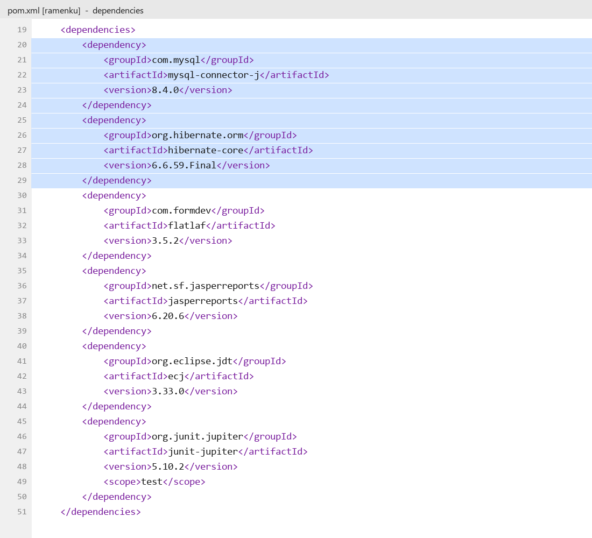

**Hasil Clean and Build di NetBeans: Hibernate ikut masuk ke aplikasi dan 20 tes lulus**

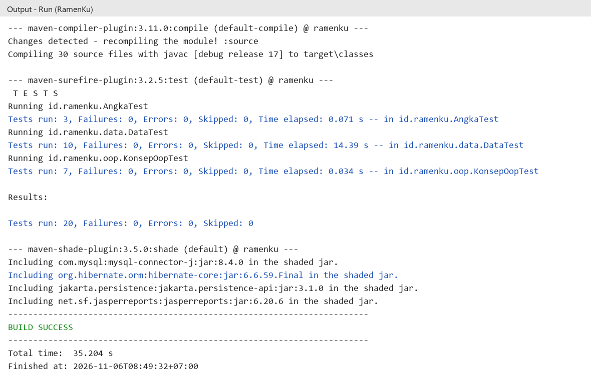

**MySQL (phpMyAdmin): database ramenku_db berisi 6 tabel yang dipetakan oleh entitas Hibernate**

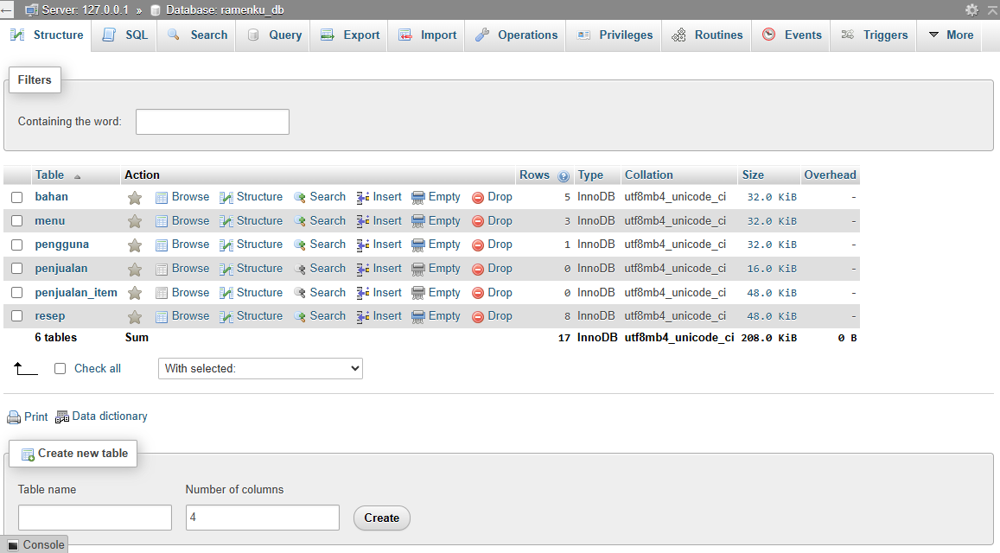

**MySQL (phpMyAdmin): isi tabel bahan, yang dibaca dan diubah oleh Hibernate**

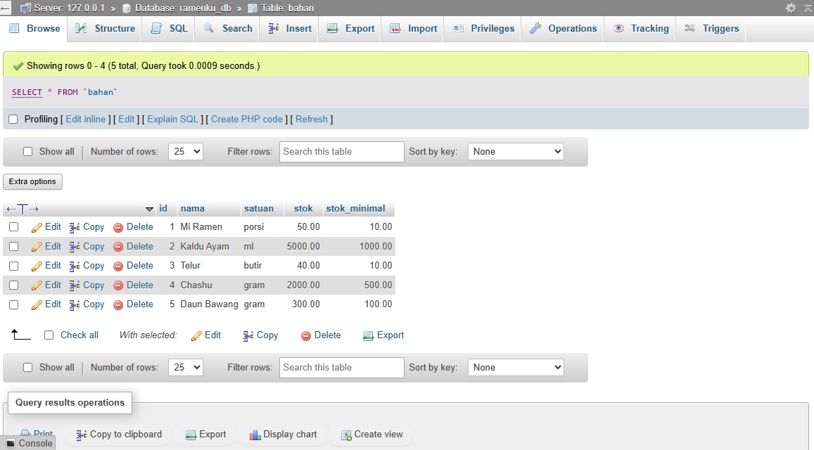

**SQL yang dibuat Hibernate sendiri di konsol: tidak ada SQL yang ditulis manual. Simpan penjualan menjadi insert nota, insert isi nota, dan update stok dalam satu transaksi**

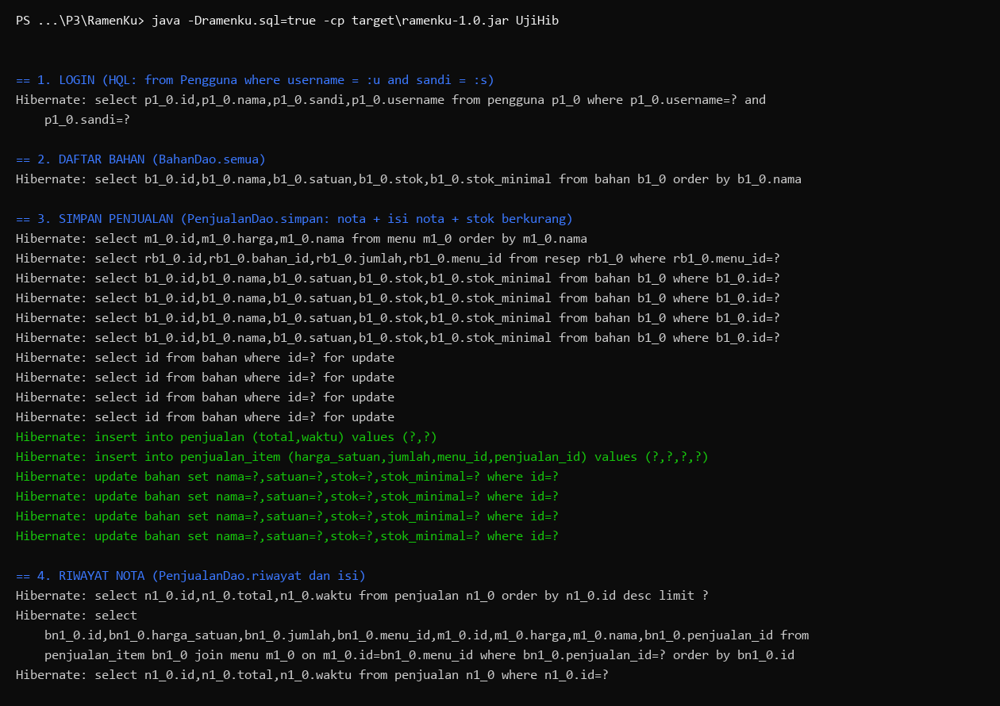

**Fitur Stok Bahan berjalan dengan Hibernate**

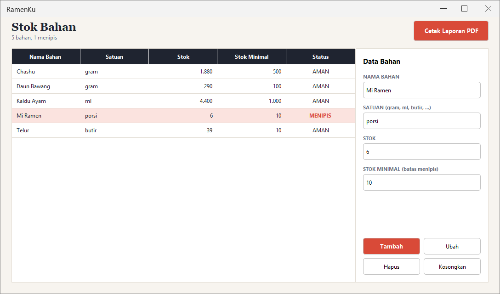

**Fitur Menu dan Resep berjalan dengan Hibernate**

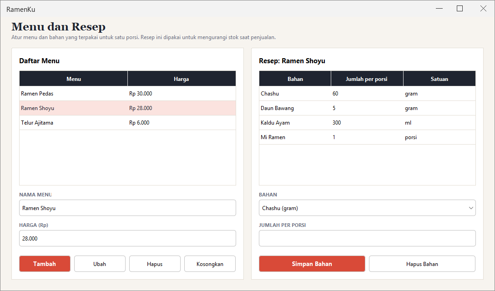

**Fitur Penjualan: kasir**

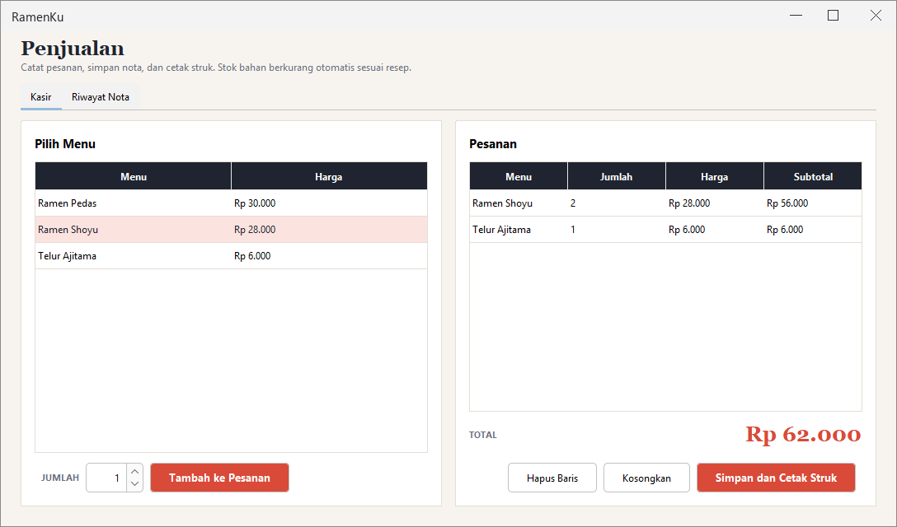

**Riwayat nota penjualan (relasi Nota ke BarisNota)**

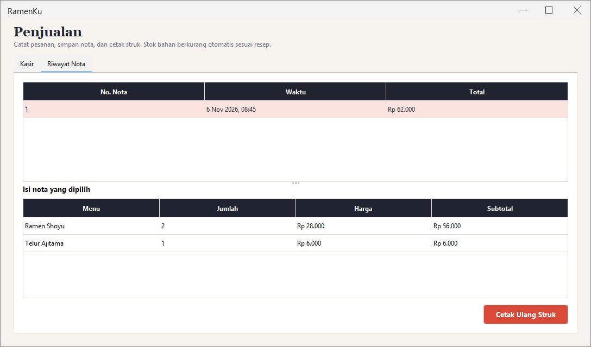

**Laporan stok bahan (PDF, JasperReports memakai koneksi dari Hibernate)**

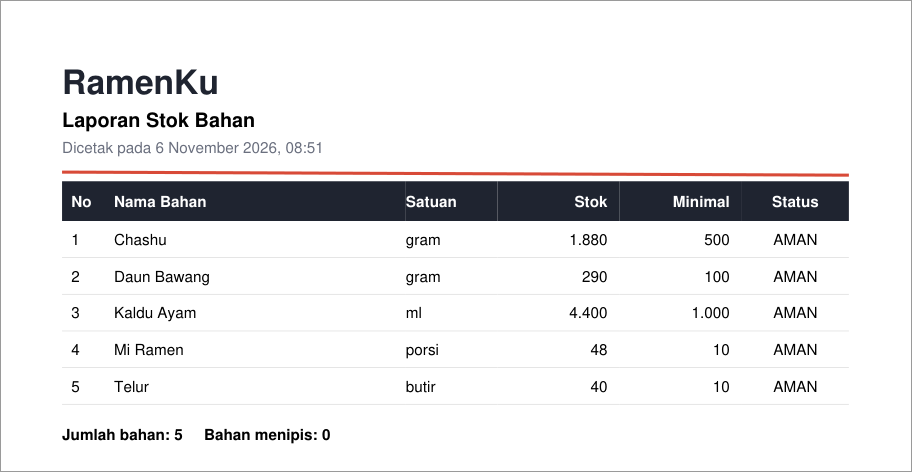

**Struk penjualan (PDF, JasperReports)**

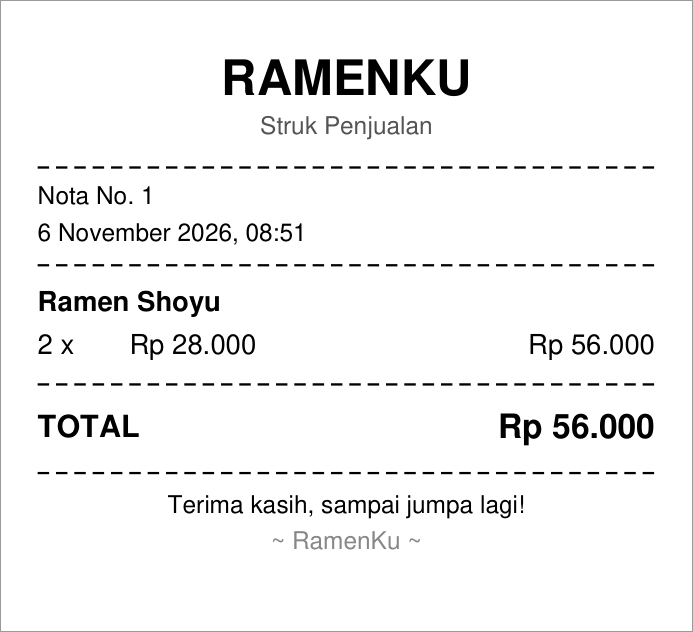

**Hasil 20 tes (OOP, angka, dan Hibernate ke MySQL)**

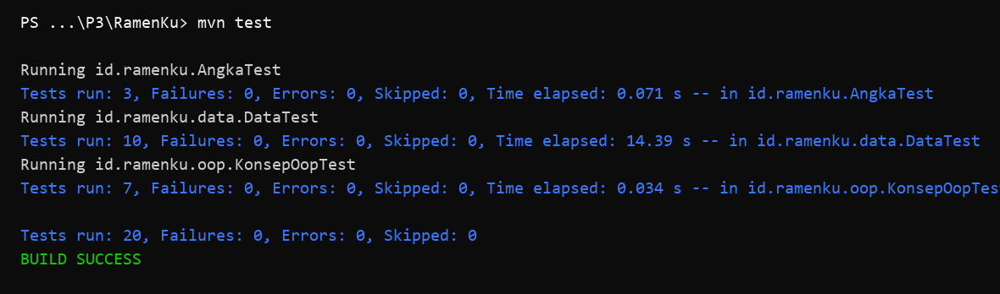
