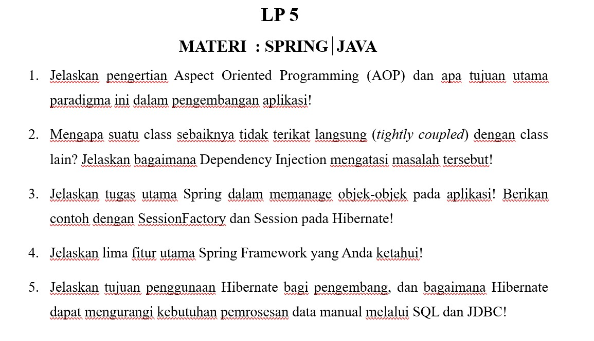

# LP 5: Spring Java

Mata praktikum Rekayasa Perangkat Lunak 2, Pertemuan 5. Jawaban oleh Bima Gunawan (NPM 50423276, 4IA24).

## Soal

## Jawaban

**1. Jelaskan pengertian Aspect Oriented Programming (AOP) dan apa tujuan utama paradigma ini dalam pengembangan aplikasi!**
AOP adalah paradigma yang memisahkan fungsi pendukung seperti _logging_, keamanan, dan transaksi dari logika bisnis utama. Tujuannya agar kode tidak berulang dan mudah dirawat.

**2. Mengapa suatu class sebaiknya tidak terikat langsung (_tightly coupled_) dengan class lain? Jelaskan bagaimana Dependency Injection mengatasi masalah tersebut!**
Class yang terikat langsung sulit diubah dan diuji karena perubahan merembet ke class lain. Dependency Injection menyuntikkan objek yang dibutuhkan dari luar, sehingga hubungan antar class menjadi longgar.

**3. Jelaskan tugas utama Spring dalam memanage objek-objek pada aplikasi! Berikan contoh dengan SessionFactory dan Session pada Hibernate!**
Spring membuat, menghubungkan, dan mengelola siklus hidup objek (_bean_). Contohnya, Spring membuat satu **SessionFactory** lalu menyuntikkannya ke DAO, dan dari situ dibuka **Session** untuk tiap operasi yang transaksinya diatur Spring.

**4. Jelaskan lima fitur utama Spring Framework yang Anda ketahui!**
1. **IoC dan Dependency Injection**: Spring yang membuat dan menyuntikkan objek.
2. **AOP**: memisahkan fungsi pendukung dari logika bisnis.
3. **Manajemen transaksi**: mengatur _commit_ dan _rollback_ secara otomatis.
4. **Spring MVC**: membangun aplikasi web dengan pola _Model-View-Controller_.
5. **Dukungan akses data**: memudahkan penggunaan JDBC, Hibernate, dan JPA.

**5. Jelaskan tujuan penggunaan Hibernate bagi pengembang, dan bagaimana Hibernate dapat mengurangi kebutuhan pemrosesan data manual melalui SQL dan JDBC!**
Hibernate memetakan class Java ke tabel sehingga pengembang bekerja dengan objek. Perintah SQL dibuat dan hasilnya diubah menjadi objek secara otomatis, jadi kode JDBC tidak perlu ditulis manual.

[Kembali ke Pertemuan 5](../README.md)
