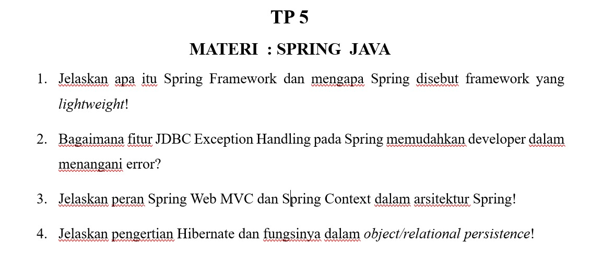

# TP 5: Spring Java

Mata praktikum Rekayasa Perangkat Lunak 2, Pertemuan 5. Jawaban oleh Bima Gunawan (NPM 50423276, 4IA24).

## Soal

## Jawaban

**1. Jelaskan apa itu Spring Framework dan mengapa Spring disebut framework yang _lightweight_!**
Spring adalah _framework_ Java untuk membangun aplikasi _enterprise_. Disebut _lightweight_ (ringan) karena hanya mengelola objek lewat Dependency Injection sehingga tidak membebani aplikasi.

**2. Bagaimana fitur JDBC Exception Handling pada Spring memudahkan developer dalam menangani error?**
_Exception_ JDBC dibuat berbentuk hierarki, sehingga error database mudah dikenali dan ditangani.

**3. Jelaskan peran Spring Web MVC dan Spring Context dalam arsitektur Spring!**
**Spring Web MVC** menyediakan pola _Model-View-Controller_ untuk aplikasi web. **Spring Context** menambah dukungan sumber pesan, pola _Observer_, dan akses sumber daya.

**4. Jelaskan pengertian Hibernate dan fungsinya dalam _object/relational persistence_!**
Hibernate adalah _tools_ yang memetakan class Java ke tabel basis data, sehingga objek dapat disimpan dan dibaca tanpa SQL dan JDBC manual.

[Kembali ke Pertemuan 5](../README.md)
