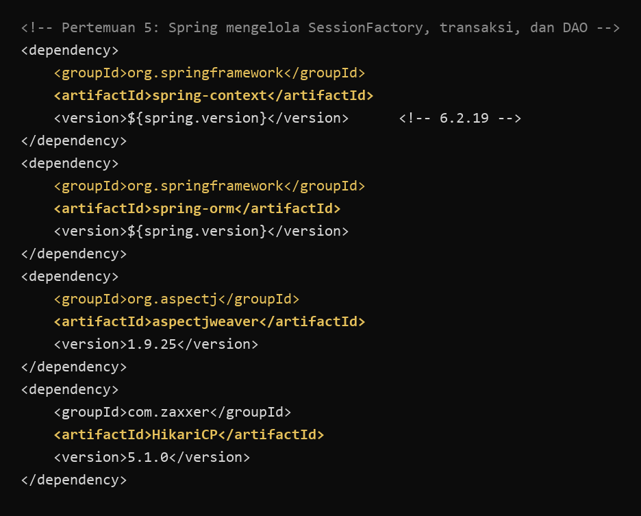
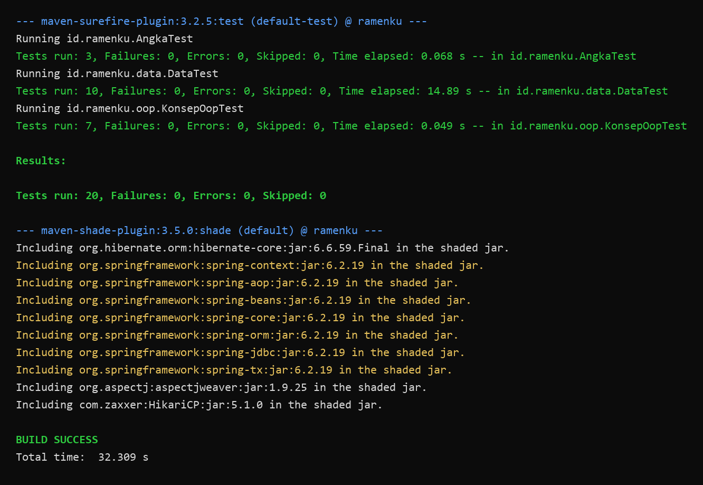
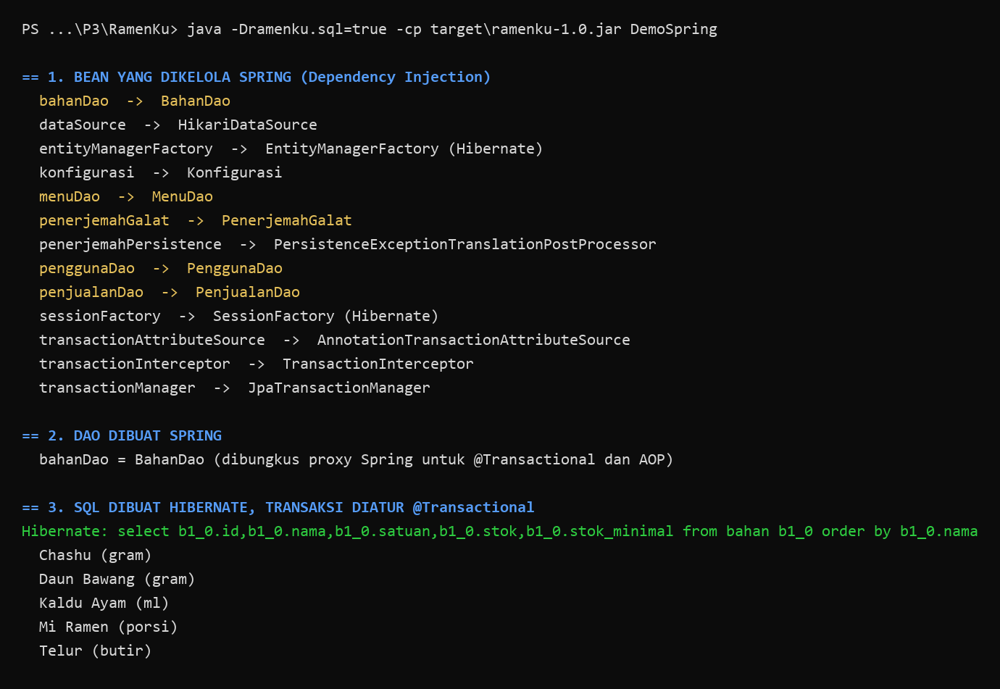
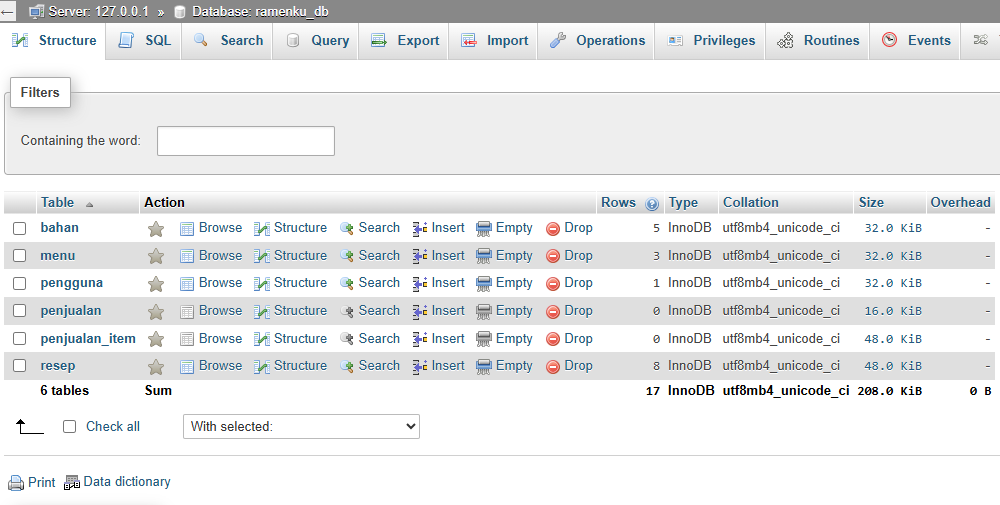
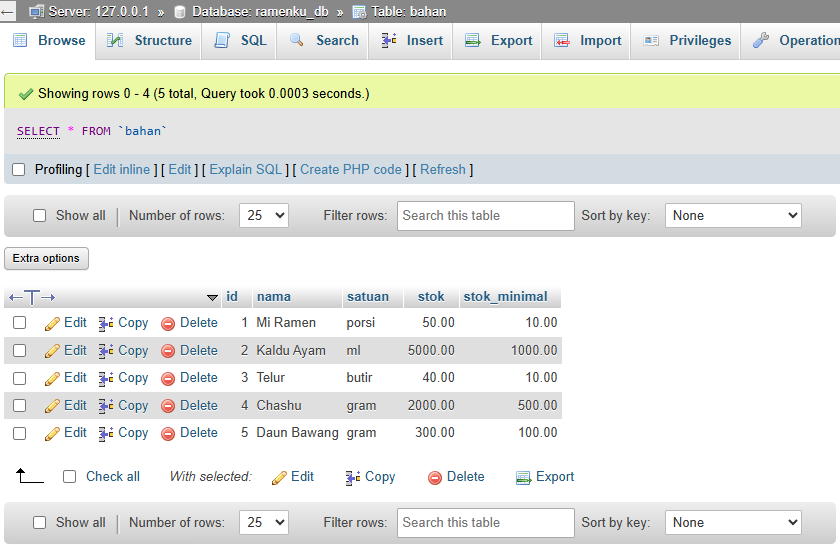
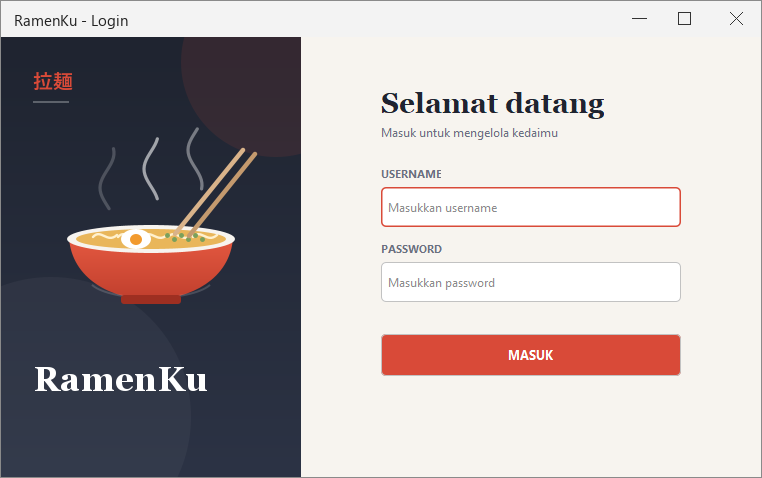
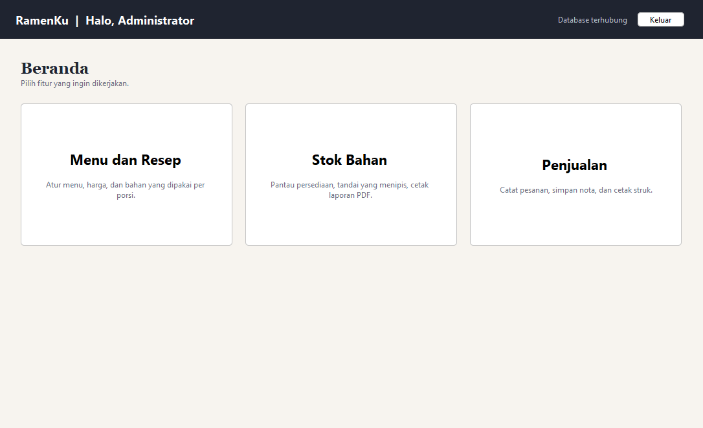
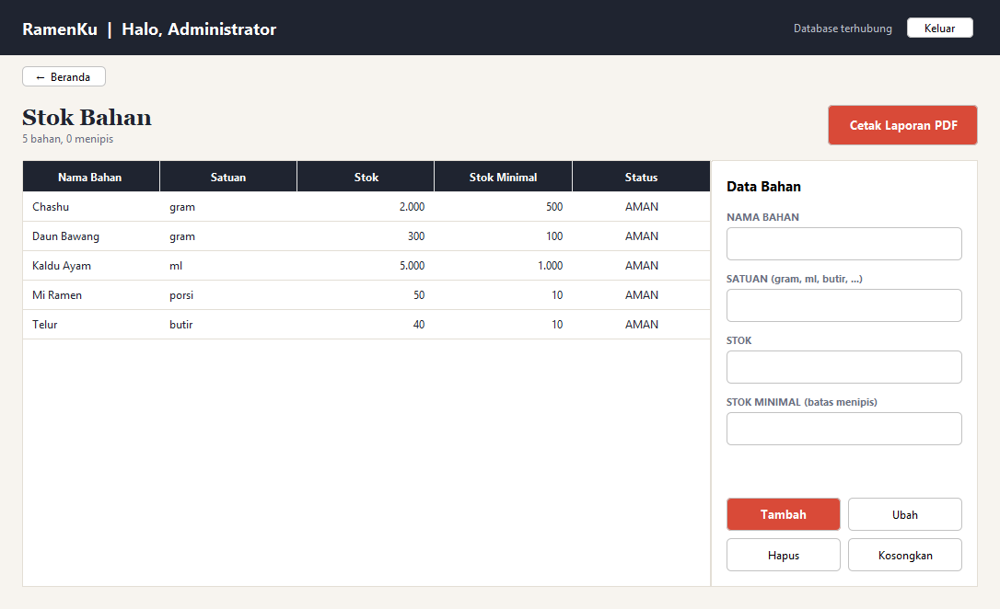
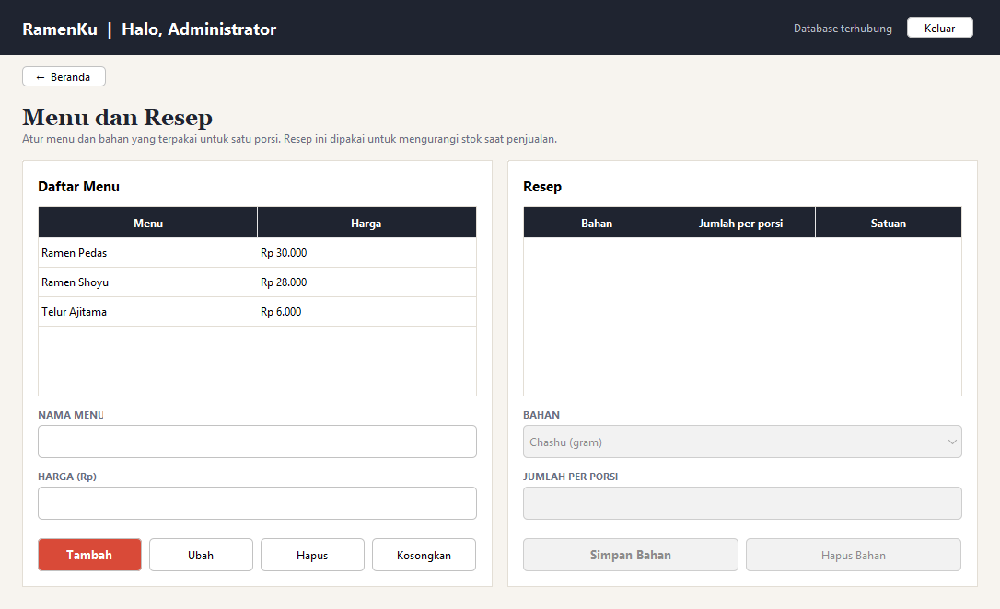
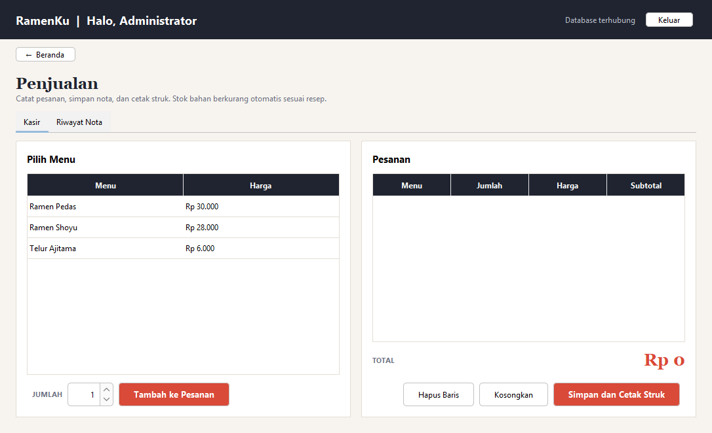

# Output Pertemuan 5: Spring Java

[Kembali ke Pertemuan 5](../README.md) | [README utama](../../README.md) | [Kode](../kode) | [LP](../LP/jawaban.md) | [TP](../TP/jawaban.md)

Spring bekerja di belakang layar, jadi tampilan aplikasi sama seperti pertemuan sebelumnya. Buktinya ada pada dependency, hasil build, objek yang dikelola Spring (gambar ketiga), dan tabel MySQL.

**Dependency Spring di pom.xml: spring-context dan spring-orm (6.2.19), aspectjweaver untuk AOP, dan HikariCP untuk kolam koneksi MySQL**

**Hasil Clean and Build di NetBeans: Spring ikut masuk ke aplikasi dan 20 tes lulus (BUILD SUCCESS)**

**Objek yang dikelola Spring: DAO, SessionFactory Hibernate, dan pengelola transaksi. Query bahan dibuat Hibernate sendiri tanpa SQL manual, dan transaksinya diatur @Transactional**

**MySQL (phpMyAdmin): database ramenku_db berisi 6 tabel yang dipetakan oleh entitas Hibernate dan dibaca lewat DAO Spring**

**MySQL (phpMyAdmin): isi tabel bahan**

**Halaman login RamenKu: pemeriksaan pengguna dilakukan PenggunaDao milik Spring**

**Beranda RamenKu setelah login: status Database terhubung dicek lewat Spring**

**Fitur Stok Bahan berjalan dengan BahanDao yang dikelola Spring**

**Fitur Menu dan Resep berjalan dengan MenuDao yang dikelola Spring**

**Fitur Penjualan (kasir) berjalan dengan PenjualanDao, transaksi diatur @Transactional**

