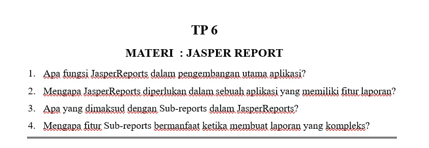

# TP 6: JasperReports

Mata praktikum Rekayasa Perangkat Lunak 2, Pertemuan 6. Jawaban oleh Bima Gunawan (NPM 50423276, 4IA24).

## Soal

## Jawaban

**1. Apa fungsi JasperReports dalam pengembangan utama aplikasi?**
JasperReports berfungsi sebagai pustaka pelaporan untuk membuat laporan dari data aplikasi, yang dapat ditampilkan, dicetak, atau diekspor ke format seperti PDF, XLS, HTML, CSV, dan TXT.

**2. Mengapa JasperReports diperlukan dalam sebuah aplikasi yang memiliki fitur laporan?**
Karena aplikasi dengan fitur laporan membutuhkan keluaran data yang rapi dan siap cetak. JasperReports memisahkan desain laporan dari kode program serta mendukung banyak format dan banyak sumber data, sehingga laporan lebih mudah dibuat dan dirawat.

**3. Apa yang dimaksud dengan Sub-reports dalam JasperReports?**
Sub-reports adalah laporan yang ditempatkan di dalam laporan lain (laporan utama). Setiap sub-report memiliki desain dan sumber data sendiri.

**4. Mengapa fitur Sub-reports bermanfaat ketika membuat laporan yang kompleks?**
Karena layout yang kompleks dapat dipecah menjadi bagian-bagian kecil yang berdiri sendiri. Setiap bagian dapat memakai sumber data berbeda dan desainnya dapat dipakai ulang, sehingga laporan yang rumit lebih mudah dibuat dan dirawat.

[Kembali ke Pertemuan 6](../README.md)
