# Output Pertemuan 6: JasperReports (PDF, Word, dan Excel)

[Kembali ke Pertemuan 6](../README.md) | [README utama](../../README.md) | [Kode](../kode)

Laporan JasperReports sekarang dapat diunduh dalam tiga format dari satu desain yang sama. Gambar-gambar pertama di bawah adalah hasil nyata dari berkas yang dibuat aplikasi lalu dibuka di Word dan Excel, dengan tampilan sebelum disegarkan. Tampilan terbaru ada di bagian [Tampilan baru](#tampilan-baru), dan berkas aslinya di folder [contoh-hasil](contoh-hasil).

**Halaman Stok Bahan dengan tombol Unduh PDF, Unduh Word, dan Unduh Excel**

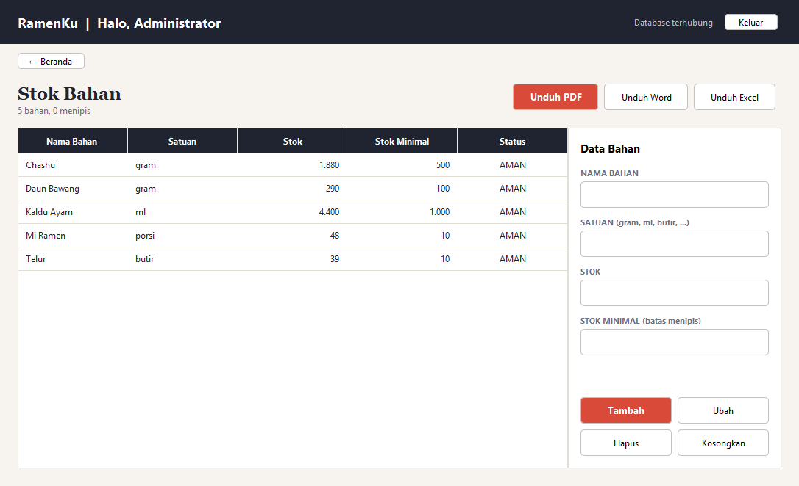

**Laporan stok bahan dalam format PDF**

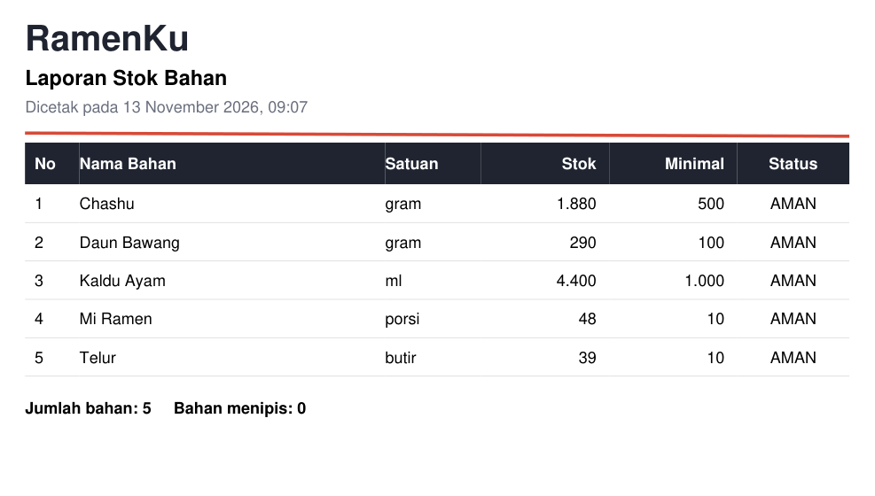

**Laporan stok bahan dalam format Word (.docx), dibuka di Microsoft Word**

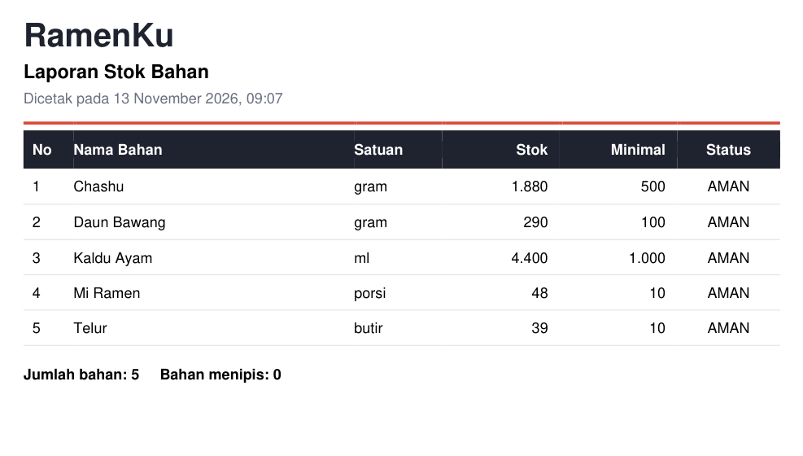

**Laporan stok bahan dalam format Excel (.xlsx), dibuka di Microsoft Excel; angka tersimpan sebagai angka**

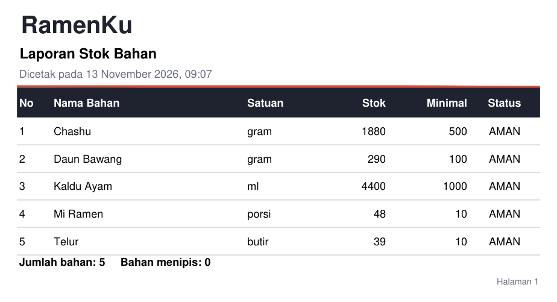

**Tab Riwayat Nota dengan tombol Unduh Struk PDF, Word, dan Excel untuk nota yang dipilih**

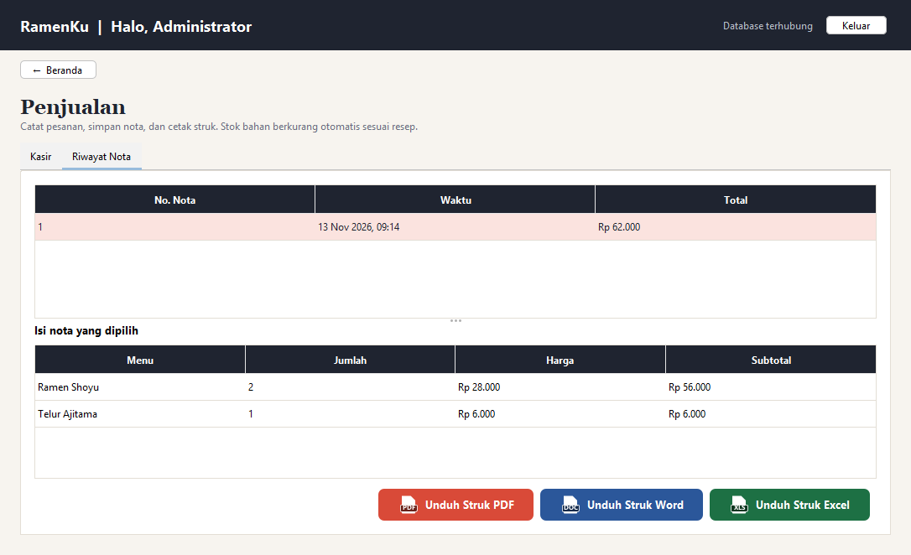

**Struk penjualan dalam format PDF**

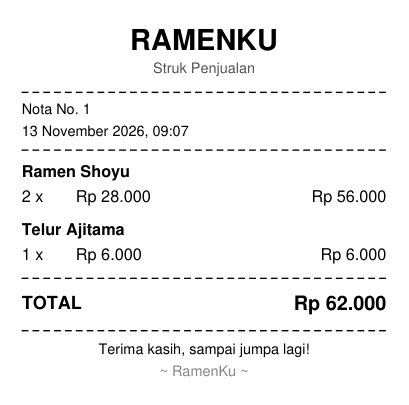

**Struk penjualan dalam format Word (.docx)**

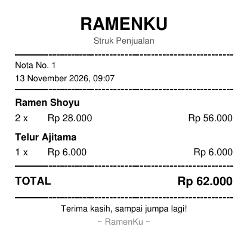

**Struk penjualan dalam format Excel (.xlsx)**

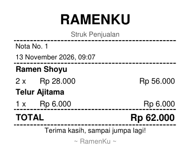

**Desain laporan stok bahan (`stok_bahan.jrxml`) dibuka di Jaspersoft Studio Community 6**

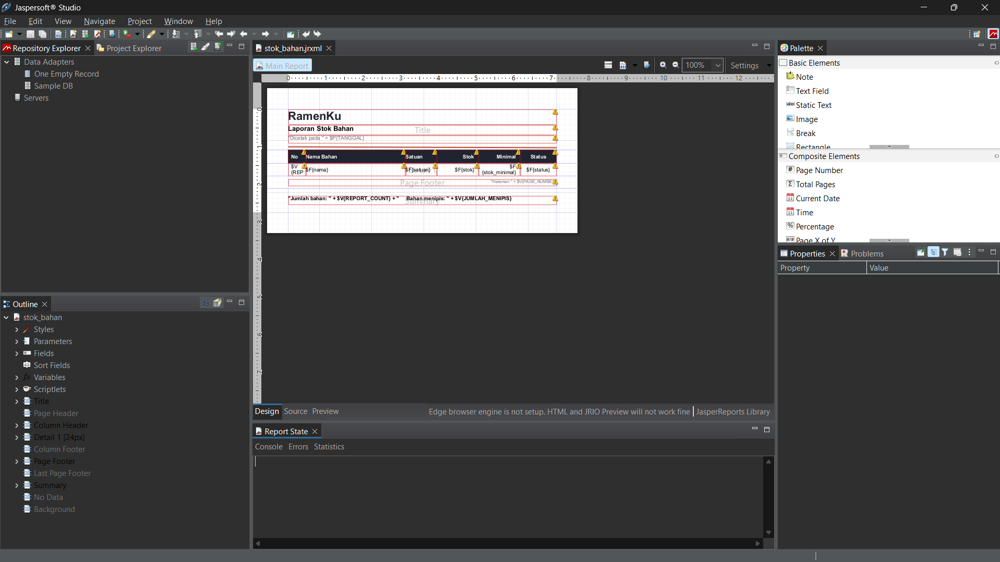

**Hasil mvn test: 21 tes lulus, termasuk pembuatan berkas Word dan Excel**

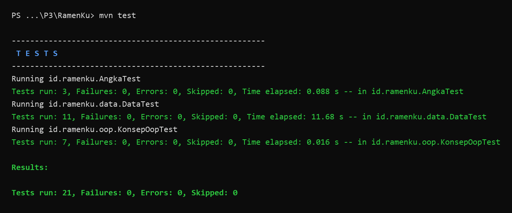

## Tampilan baru

Setelah gambar-gambar di atas diambil, tampilan aplikasi dan desain laporan disegarkan dengan warna bahan ramen: krim kaldu, cokelat shoyu, oranye miso, dan kuning mi. Berikut tampilan terbarunya, dan berkas di [contoh-hasil](contoh-hasil) sudah memakai desain laporan yang baru.

**Login: mangkuk ramen dilihat dari atas, lengkap dengan mi, telur, naruto, nori, chashu, dan daun bawang**

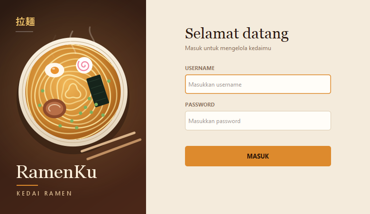

**Beranda**

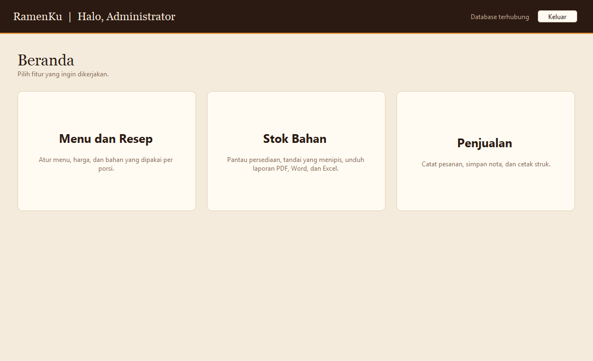

**Stok Bahan dengan tombol Unduh PDF, Word, dan Excel**

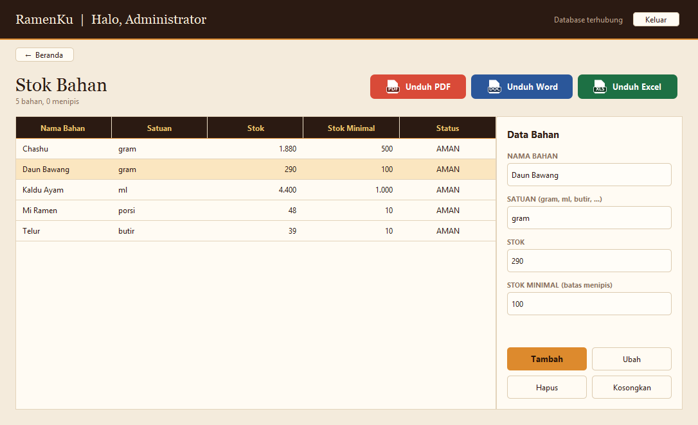

**Menu dan Resep**

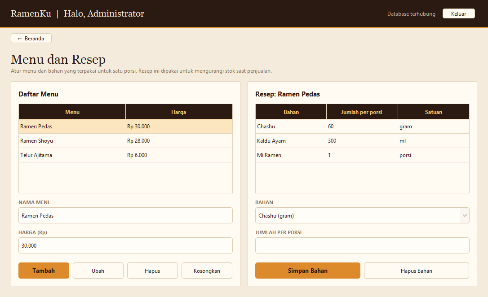

**Penjualan: kasir**

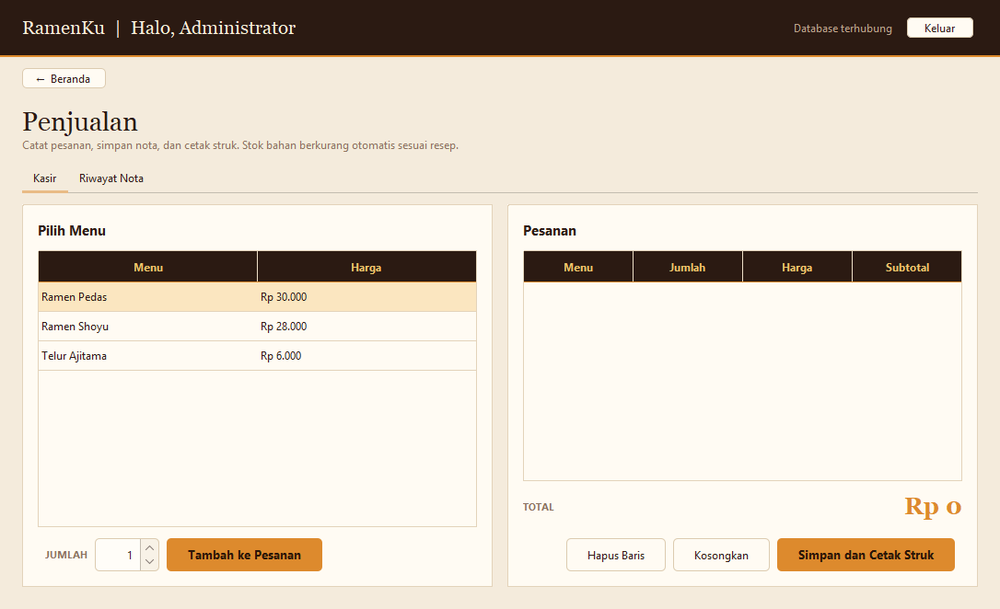

**Penjualan: riwayat nota dan unduh struk**

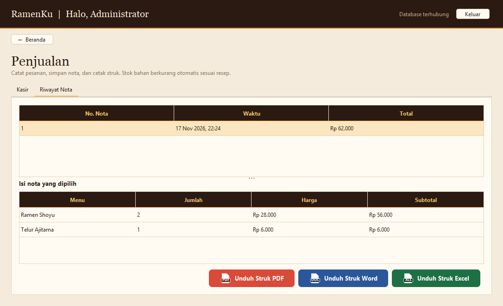

**Laporan stok bahan (PDF) dengan desain baru**

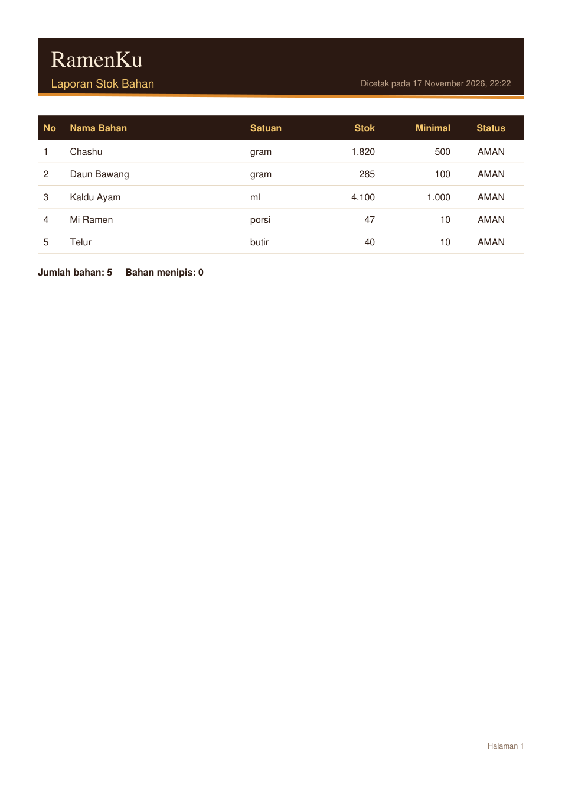

**Struk penjualan (PDF) dengan desain baru**

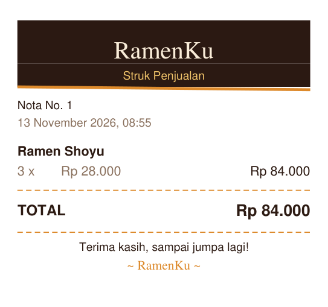

## Contoh berkas hasil unduhan

| Laporan | PDF | Word | Excel |
|---|---|---|---|
| Laporan stok bahan | [PDF](contoh-hasil/Laporan_Stok_Bahan.pdf) | [Word](contoh-hasil/Laporan_Stok_Bahan.docx) | [Excel](contoh-hasil/Laporan_Stok_Bahan.xlsx) |
| Struk penjualan | [PDF](contoh-hasil/Struk_Penjualan.pdf) | [Word](contoh-hasil/Struk_Penjualan.docx) | [Excel](contoh-hasil/Struk_Penjualan.xlsx) |
