# Proses dan hasil: laporan JasperReports RamenKu

[Kembali ke output Pertemuan 6](../README.md) | [Pertemuan 6](../../README.md) | [Panduan Jaspersoft](../../jaspersoft/README.md)

Urutan pengerjaan laporan dari desain sampai hasil akhir, lengkap dengan keluarannya di setiap langkah. Desain yang dipakai: `stok_bahan.jrxml` dan `struk.jrxml` di [`src/main/resources/laporan`](../../../src/main/resources/laporan).

Proses langkah demi langkah di dalam Jaspersoft Studio (menyambungkan database, Preview, dan ekspor) ada di [output/studio](../studio/README.md).

## 1. Desain laporan di Jaspersoft Studio

Berkas `stok_bahan.jrxml` dibuka di Jaspersoft Studio Community 6: band Title (bilah judul), Column Header, Detail, Page Footer, dan Summary.

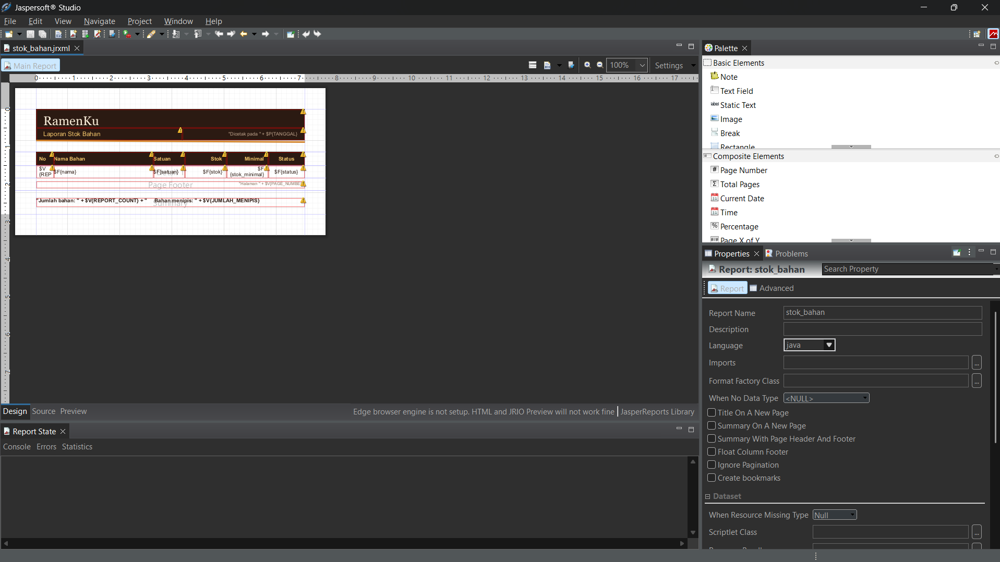

## 2. Menjalankan ekspor

`ekspor.bat` mengompilasi desain, mengisi data dari MySQL lewat JDBC, lalu mengekspor satu laporan ke PDF, Word, dan Excel. Satu kali jalan untuk laporan stok, dan satu kali untuk struk nota nomor 1.

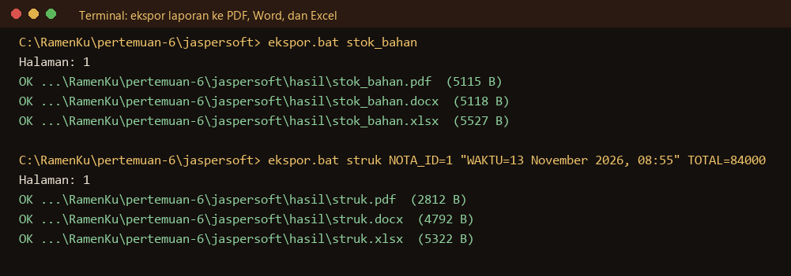

## 3. Laporan stok bahan

**PDF**

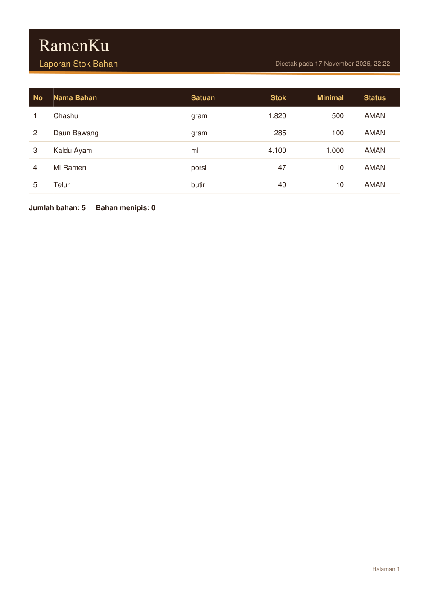

**Word (.docx), dibuka di Microsoft Word**

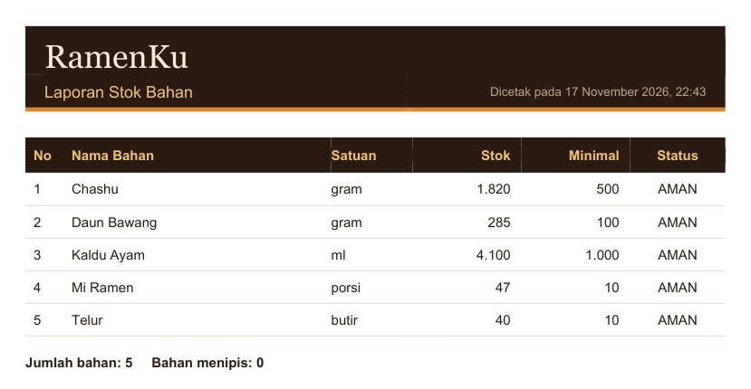

**Excel (.xlsx), dibuka di Microsoft Excel; angka tersimpan sebagai angka**

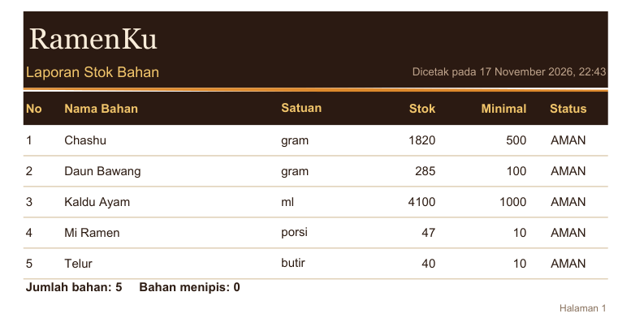

## 4. Struk penjualan

**PDF**

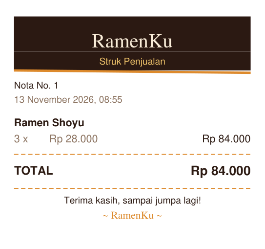

**Word (.docx)**

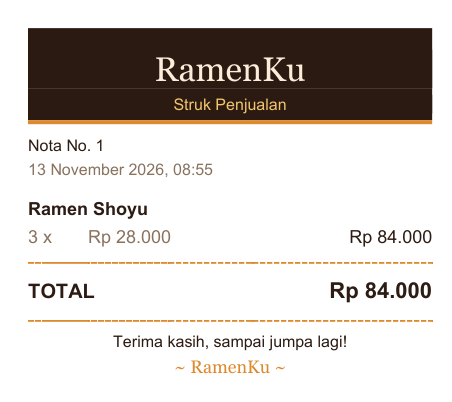

**Excel (.xlsx)**

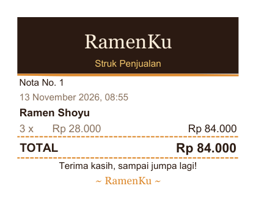

## 5. Dari dalam aplikasi

Hasil yang sama keluar lewat tombol **Unduh PDF**, **Unduh Word**, dan **Unduh Excel** pada halaman Stok Bahan, dan tombol **Unduh Struk** pada Riwayat Nota.

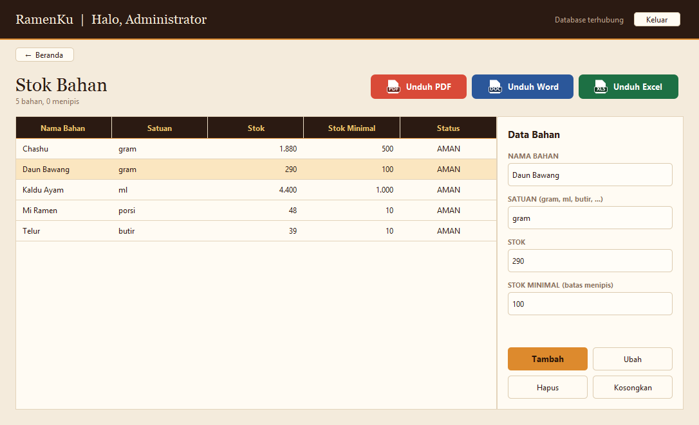

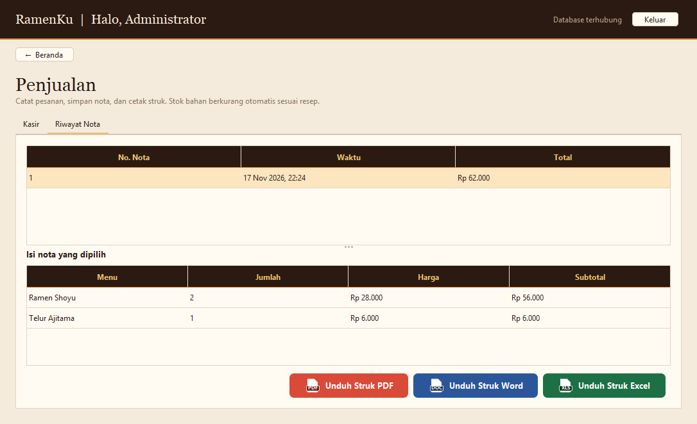

## 6. Pengujian

`mvn test` menjalankan 21 tes otomatis, termasuk pembuatan berkas PDF, Word, dan Excel.

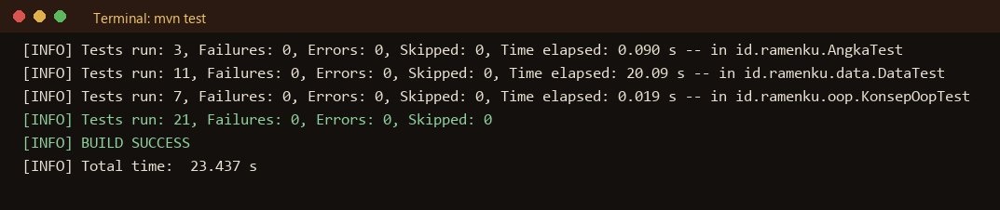

## Berkas hasil

Berkas aslinya ada di [contoh-hasil](../contoh-hasil): `Laporan_Stok_Bahan` dan `Struk_Penjualan` dalam format `.pdf`, `.docx`, dan `.xlsx`.
