# Proses di Jaspersoft Studio: laporan stok bahan

[Kembali ke output Pertemuan 6](../README.md) | [Proses dan hasil](../proses/README.md) | [Panduan Jaspersoft](../../jaspersoft/README.md)

Langkah demi langkah menampilkan dan mengekspor laporan `stok_bahan.jrxml` langsung di Jaspersoft Studio Community 6, dengan data asli dari MySQL (`ramenku_db`).

## A. Menyambungkan database

**1. Membuat data adapter baru** (Repository Explorer, klik kanan *Data Adapters*, *Create Data Adapter*), lalu memilih jenis **Database JDBC Connection**.

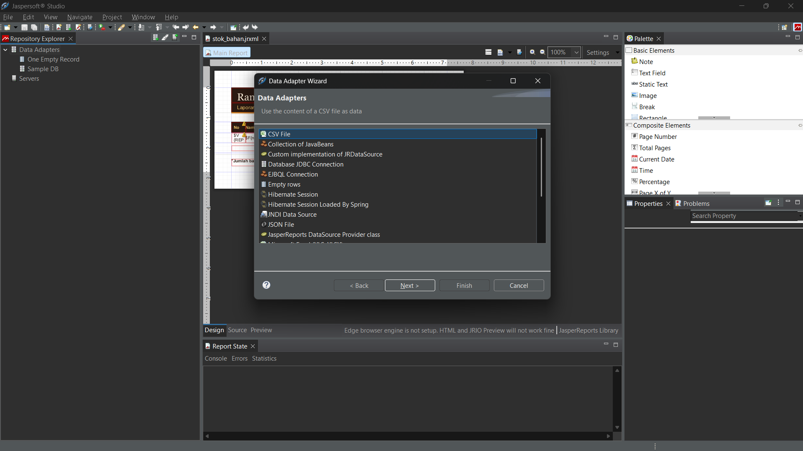

**2. Mengisi formulir:** nama `RamenKu`, driver `com.mysql.cj.jdbc.Driver`, URL `jdbc:mysql://localhost:3306/ramenku_db`, user `root`, password kosong.

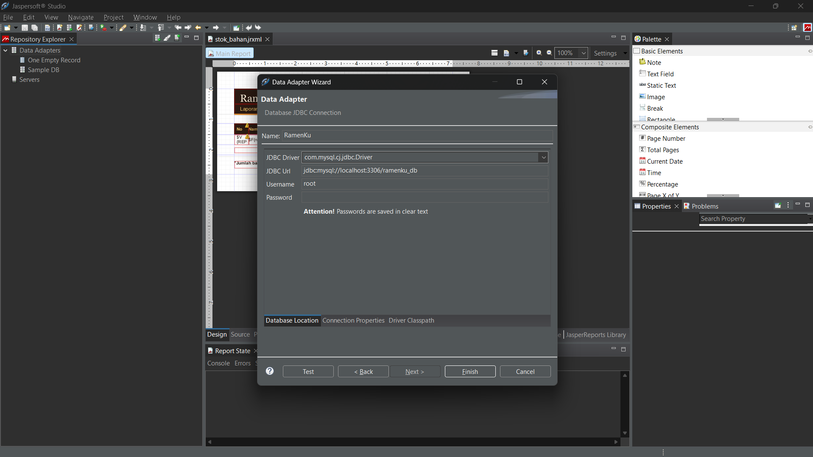

**3. Menambahkan driver MySQL** pada tab *Driver Classpath* (berkas `ramenku-1.0.jar` sudah memuat driver).

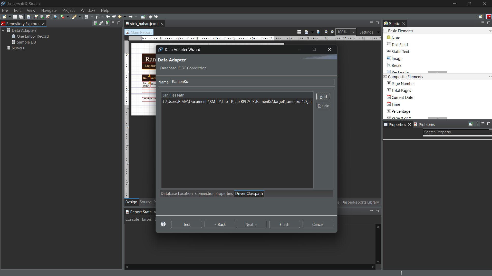

**4. Menguji koneksi:** tombol *Test* menampilkan **Successful**.

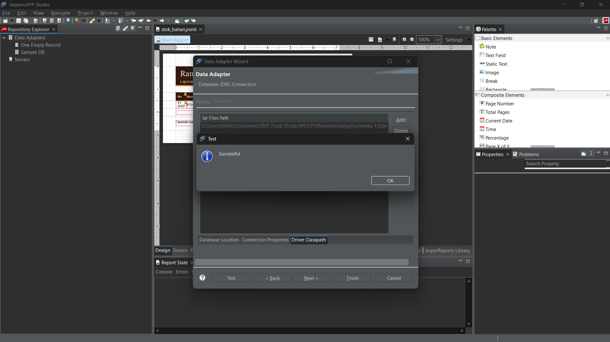

**5. Adapter `RamenKu` kini terdaftar** di daftar Data Adapters.

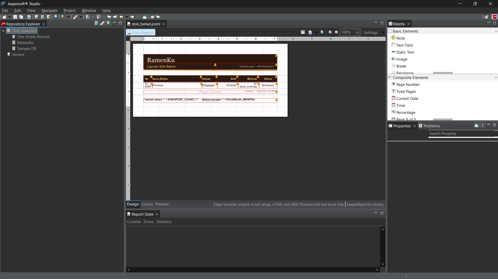

## B. Menjalankan laporan

**6. Membuka tab Preview.** Laporan meminta parameter `TANGGAL`, yang diisi teks tanggal cetak.

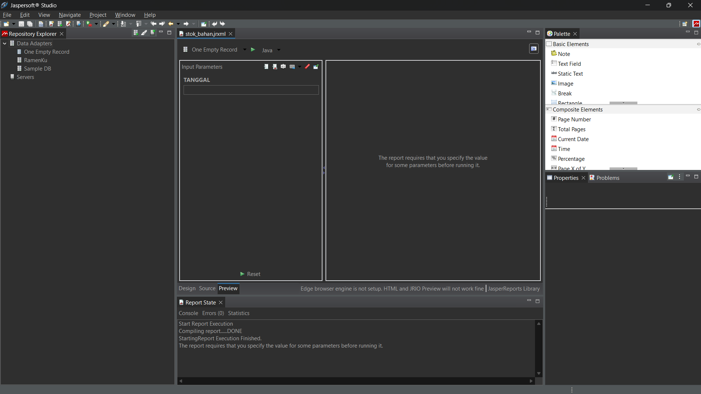

**7. Memilih adapter `RamenKu` lalu menjalankan laporan.** Tabel stok tampil dengan 5 bahan, dan statistik mencatat 5 records, 1 halaman, tanpa galat.

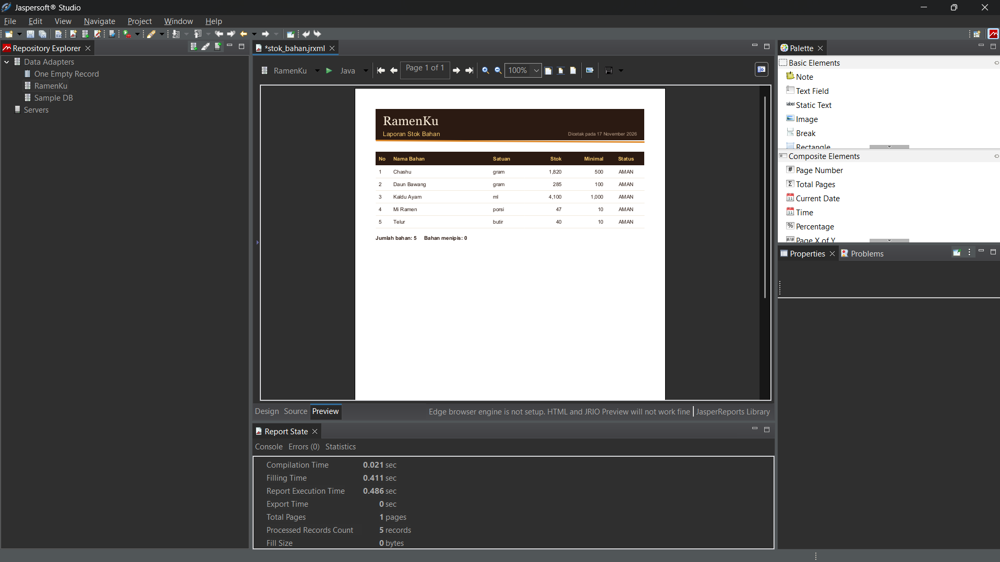

## C. Mengekspor

**8. Menu ekspor** menawarkan banyak format. Yang dipakai: PDF, Word (`.docx`), dan Excel (`.xlsx`).

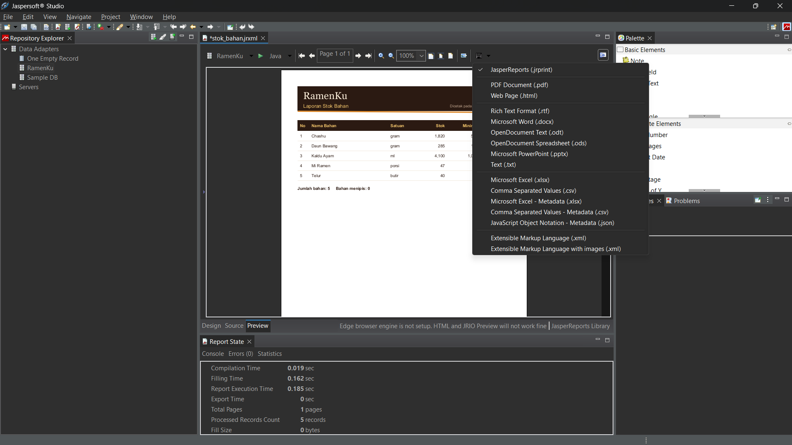

**9. Menyimpan hasil** ke folder output dengan nama `stok_bahan_studio`.

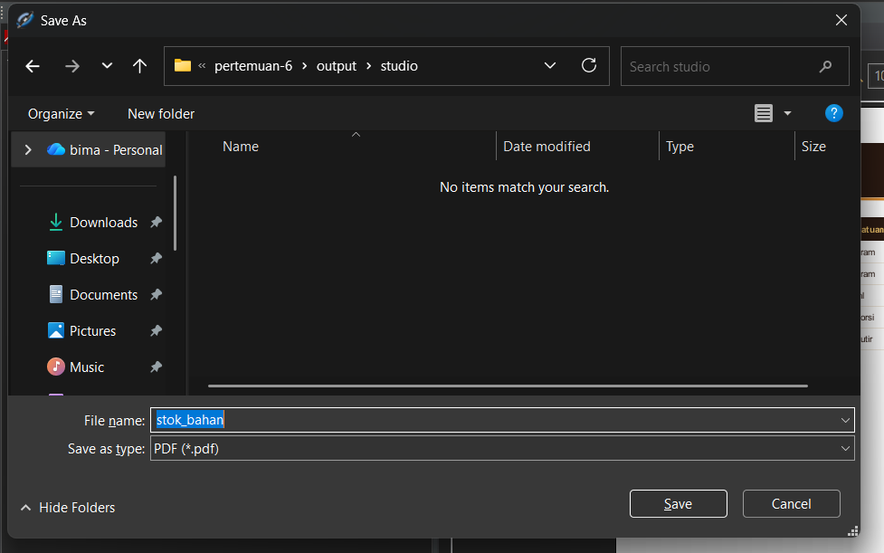

## D. Hasil ekspor dari Studio

**PDF:** [stok_bahan_studio.pdf](stok_bahan_studio.pdf)

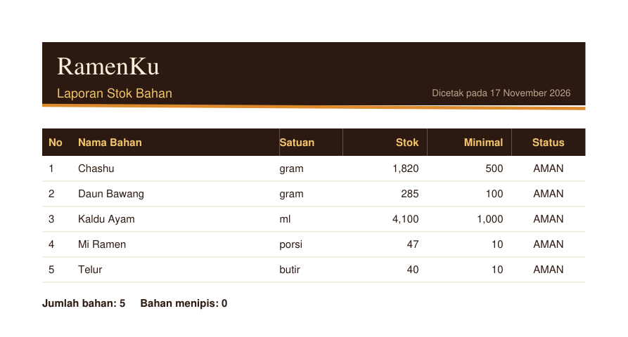

**Word:** [stok_bahan_studio.docx](stok_bahan_studio.docx)

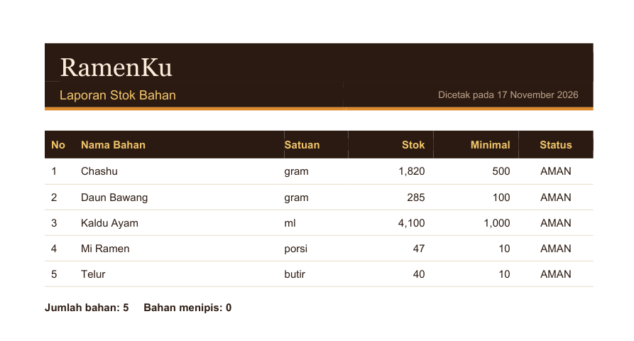

**Excel:** [stok_bahan_studio.xlsx](stok_bahan_studio.xlsx)

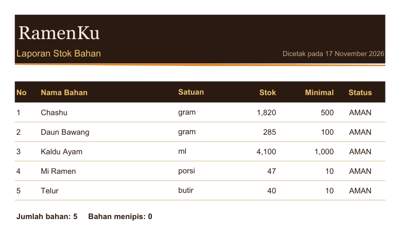
