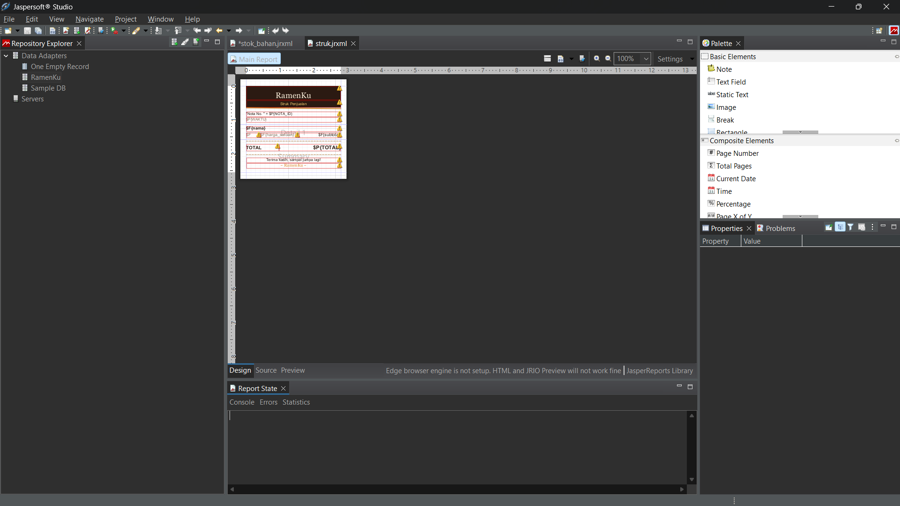
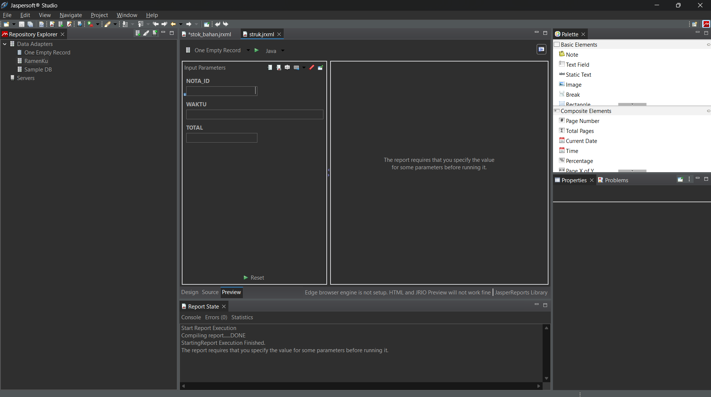
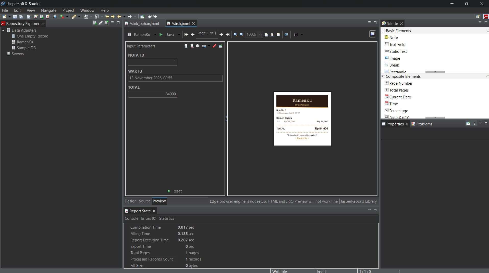
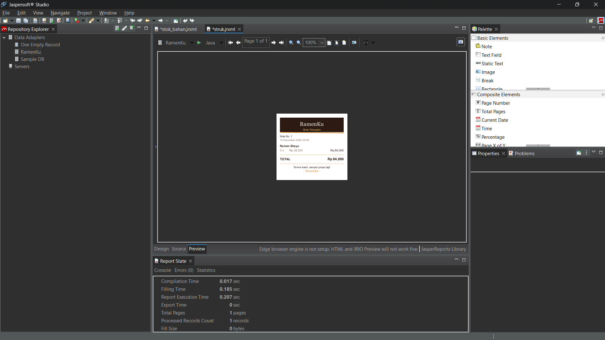
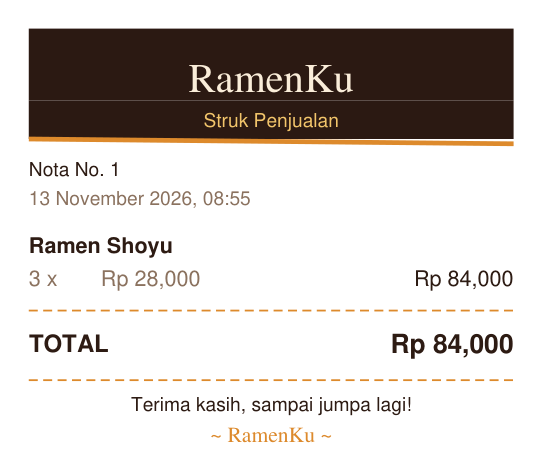
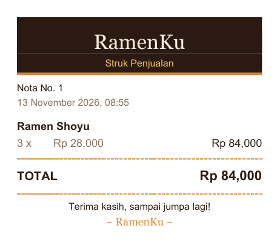
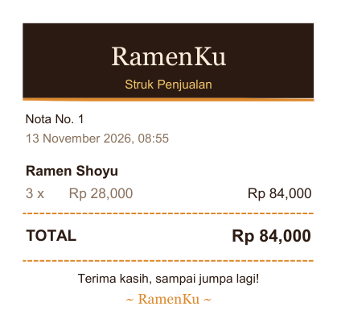

# Proses di Jaspersoft Studio: struk penjualan

[Kembali ke proses laporan stok](../README.md) | [Output Pertemuan 6](../../README.md) | [Proses dan hasil](../../proses/README.md)

Langkah menampilkan dan mengekspor `struk.jrxml` di Jaspersoft Studio. Koneksi database memakai adapter `RamenKu` yang sama seperti pada [laporan stok](../README.md).

**1. Membuka `struk.jrxml`** lewat *File, Open File*. Tampilan Design menunjukkan bilah judul, nota, daftar menu, total, dan ucapan terima kasih.

**2. Tab Preview.** Struk punya tiga parameter: `NOTA_ID`, `WAKTU`, dan `TOTAL`.

**3. Mengisi parameter dan menjalankan.** `NOTA_ID` diisi `1` (nota nomor 1 di database), `WAKTU` diisi `13 November 2026, 08:55`, `TOTAL` diisi `84000`. Adapter yang dipakai `RamenKu`.

**4. Hasil Preview.** Struk tampil dengan data nota dari database: Ramen Shoyu 3 x Rp 28.000, total Rp 84.000. Statistik mencatat 1 record dan tanpa galat.

## Hasil ekspor dari Studio

Diekspor dari menu ekspor yang sama seperti laporan stok, dengan nama `struk_studio`.

**PDF:** [struk_studio.pdf](struk_studio.pdf)

**Word:** [struk_studio.docx](struk_studio.docx)

**Excel:** [struk_studio.xlsx](struk_studio.xlsx)

