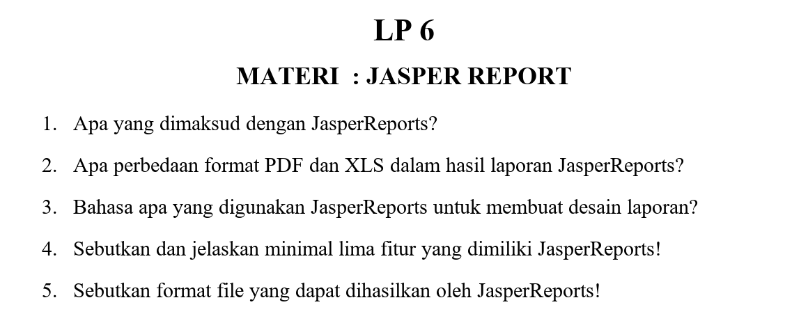

# LP 6: JasperReports

Mata praktikum Rekayasa Perangkat Lunak 2, Pertemuan 6. Jawaban oleh Bima Gunawan (NPM 50423276, 4IA24).

## Soal

## Jawaban

**1. Apa yang dimaksud dengan JasperReports?**
JasperReports adalah pustaka pelaporan (_reporting library_) open source berbasis Java yang dipakai untuk membuat laporan dari data, misalnya dari database. Laporan itu dapat ditampilkan, dicetak, atau diekspor ke berbagai format seperti PDF, Word, dan Excel.

**2. Apa perbedaan format PDF dan XLS dalam hasil laporan JasperReports?**
PDF menjaga tata letak halaman tetap sama persis dengan desain, sehingga cocok untuk dibaca dan dicetak, tetapi isinya sulit diubah. XLS berupa lembar kerja Excel yang isinya tersusun dalam sel dan angka, sehingga dapat diedit dan dihitung lagi, tetapi tata letaknya bisa sedikit berbeda dari desain.

**3. Bahasa apa yang digunakan JasperReports untuk membuat desain laporan?**
JasperReports memakai bahasa **XML**. Desain laporan ditulis dalam berkas **.jrxml**, lalu dikompilasi menjadi berkas **.jasper** sebelum diisi dengan data.

**4. Sebutkan dan jelaskan minimal lima fitur yang dimiliki JasperReports!**
1. **Banyak sumber data**: dapat memakai database (JDBC), koleksi objek Java, XML, dan CSV.
2. **Desain berbasis band**: laporan disusun dari bagian seperti judul, header, detail, dan ringkasan.
3. **Parameter, field, dan variabel**: untuk memasukkan nilai dari luar, membaca kolom data, dan menghitung total.
4. **Grup dan subreport**: data dapat dikelompokkan, dan satu laporan dapat memuat laporan lain di dalamnya.
5. **Grafik dan gambar**: laporan dapat memuat diagram, gambar, dan kode batang.
6. **Ekspor ke banyak format**: satu desain dapat dihasilkan menjadi berbagai jenis berkas.

**5. Sebutkan format file yang dapat dihasilkan oleh JasperReports!**
PDF, HTML, Word (DOC dan DOCX), Excel (XLS dan XLSX), RTF, ODT, ODS, CSV, XML, dan teks biasa (TXT).

[Kembali ke Pertemuan 6](../README.md)
