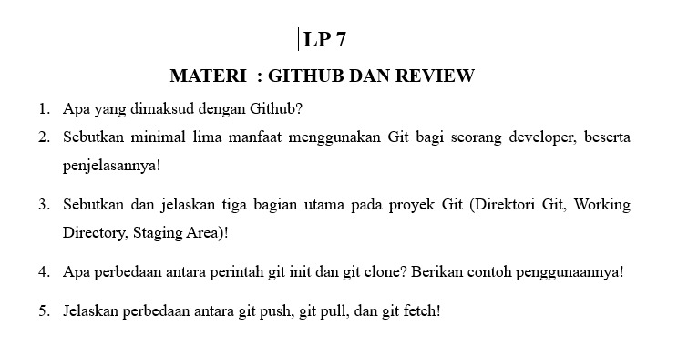

# LP 7: GitHub dan Review

Mata praktikum Rekayasa Perangkat Lunak 2, Pertemuan 7. Jawaban oleh Bima Gunawan (NPM 50423276, 4IA24).

## Soal



## Jawaban

**1. Apa yang dimaksud dengan GitHub?**
GitHub adalah layanan hosting repositori berbasis web yang memakai sistem kontrol versi **Git**. GitHub dipakai untuk menyimpan kode secara daring, mencatat riwayat perubahannya, dan berkolaborasi dengan developer lain melalui fitur seperti _pull request_, _issue_, dan _code review_.

**2. Sebutkan minimal lima manfaat menggunakan Git bagi seorang developer, beserta penjelasannya!**
1. **Mencatat riwayat perubahan**: setiap perubahan tersimpan sebagai _commit_, sehingga dapat dilihat siapa mengubah apa dan kapan.
2. **Kembali ke versi sebelumnya**: bila terjadi kesalahan, kode dapat dikembalikan ke versi yang masih benar.
3. **Branching**: fitur baru dapat dikerjakan di cabang terpisah tanpa mengganggu kode utama, lalu digabungkan (_merge_) setelah selesai.
4. **Kolaborasi tim**: banyak developer dapat mengerjakan proyek yang sama secara bersamaan, dan perubahan mereka digabungkan dengan rapi.
5. **Cadangan kode**: repositori dapat disimpan di server jarak jauh (misalnya GitHub), sehingga kode tetap aman bila komputer rusak.
6. **Bekerja secara offline**: Git bersifat terdistribusi, sehingga _commit_ dan riwayat tetap dapat diakses tanpa internet.

**3. Sebutkan dan jelaskan tiga bagian utama pada proyek Git (Direktori Git, Working Directory, Staging Area)!**
1. **Direktori Git (_repository_)**: folder `.git` yang menyimpan seluruh riwayat _commit_ dan metadata proyek. Bagian ini yang disalin saat melakukan _clone_.
2. **Working Directory**: folder kerja berisi berkas proyek yang sedang diedit oleh developer.
3. **Staging Area**: area persiapan yang menampung perubahan yang akan disimpan pada _commit_ berikutnya. Berkas masuk ke staging area dengan perintah `git add`, lalu disimpan ke Direktori Git dengan `git commit`.

**4. Apa perbedaan antara perintah git init dan git clone? Berikan contoh penggunaannya!**
`git init` membuat repositori Git baru yang masih kosong di folder lokal, sedangkan `git clone` menyalin repositori yang sudah ada (biasanya dari server seperti GitHub) beserta seluruh riwayatnya ke komputer lokal.

```bash
git init                                              # membuat repositori baru di folder saat ini
git clone https://github.com/bimagwn/BimaGunawan.git  # menyalin repositori dari GitHub
```

**5. Jelaskan perbedaan antara git push, git pull, dan git fetch!**
- **git push**: mengirim _commit_ dari repositori lokal ke repositori jarak jauh (_remote_).
- **git pull**: mengambil perubahan dari _remote_ lalu langsung menggabungkannya ke branch lokal (sama dengan `git fetch` lalu `git merge`).
- **git fetch**: mengambil perubahan dari _remote_ tanpa menggabungkannya, sehingga perubahan dapat diperiksa dulu sebelum digabung.
