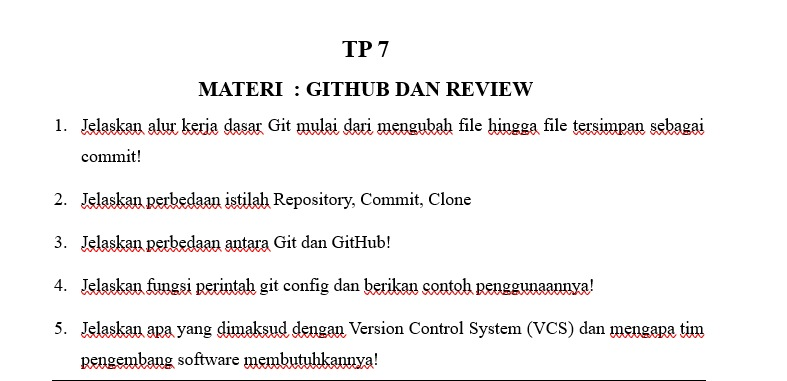

# TP 7: GitHub dan Review

Mata praktikum Rekayasa Perangkat Lunak 2, Pertemuan 7. Jawaban oleh Bima Gunawan (NPM 50423276, 4IA24).

## Soal



## Jawaban

**1. Jelaskan alur kerja dasar Git mulai dari mengubah file hingga file tersimpan sebagai commit!**
1. File diubah di **Working Directory**.
2. Perubahan dimasukkan ke **Staging Area** dengan `git add`.
3. Perubahan disimpan ke **repositori** sebagai commit dengan `git commit -m "pesan"`.

**2. Jelaskan perbedaan istilah Repository, Commit, Clone!**
- **Repository**: tempat penyimpanan proyek beserta seluruh riwayat perubahannya.
- **Commit**: satu catatan perubahan yang disimpan ke repository, disertai pesan.
- **Clone**: menyalin repository dari _remote_ (misalnya GitHub) ke komputer lokal.

**3. Jelaskan perbedaan antara Git dan GitHub!**
**Git** adalah sistem kontrol versi yang berjalan di komputer lokal untuk mencatat perubahan kode. **GitHub** adalah layanan web untuk menyimpan repository Git secara daring dan berkolaborasi.

**4. Jelaskan fungsi perintah git config dan berikan contoh penggunaannya!**
`git config` berfungsi mengatur konfigurasi Git, misalnya nama dan email yang dicatat pada setiap commit.

```bash
git config --global user.name "Bima Gunawan"
git config --global user.email "email@contoh.com"
```

**5. Jelaskan apa yang dimaksud dengan Version Control System (VCS) dan mengapa tim pengembang software membutuhkannya!**
VCS adalah sistem yang mencatat setiap perubahan pada berkas sehingga versi sebelumnya dapat dilihat atau dikembalikan. Tim membutuhkannya agar dapat bekerja bersama tanpa saling menimpa pekerjaan, melacak siapa mengubah apa, dan memulihkan kode bila terjadi kesalahan.
