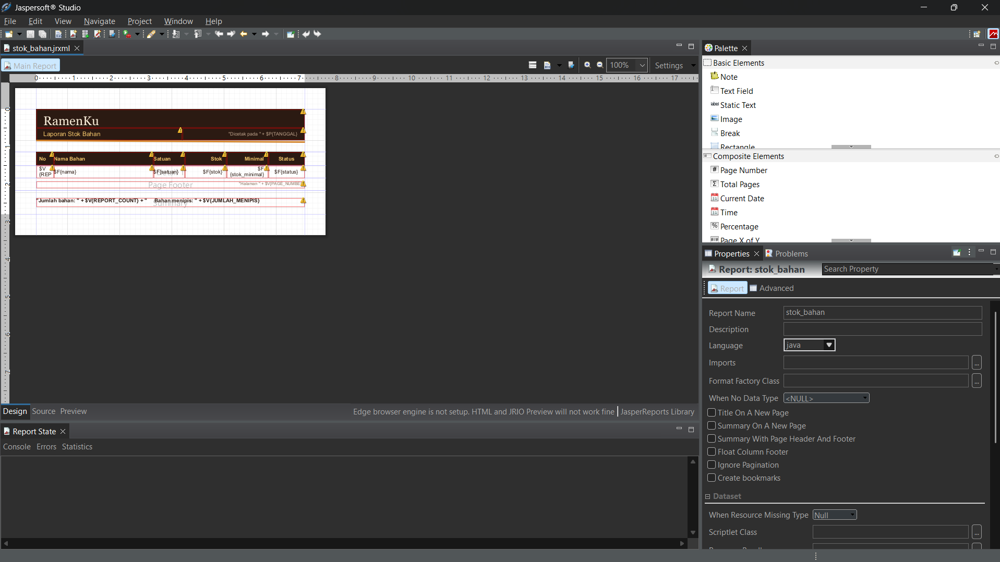

# 🧰 Jaspersoft Studio untuk RamenKu

Jaspersoft Studio adalah aplikasi untuk merancang laporan JasperReports secara visual. Desain laporan RamenKu (`stok_bahan.jrxml` dan `struk.jrxml`) bisa dibuka di dalamnya.



## Memasang

Praktikum memakai **Jaspersoft Studio Community, versi 6** (di laptop ini 6.21.5).

1. Unduh dari halaman resmi Jaspersoft Community (community.jaspersoft.com), pilih Jaspersoft Studio Community untuk Windows. Unduhan butuh akun gratis dan persetujuan lisensi.
2. Ekstrak berkas zip ke folder baru.
3. Buka `Jaspersoft Studioc.exe` (versi dengan jendela konsol; jendela hitamnya jangan ditutup).
4. Klik **Launch** pada pilihan workspace, lalu masuk dengan akun Jaspersoft Community.

Programnya tidak disertakan di repo ini karena ukurannya sekitar 385 MB (batas GitHub 100 MB per berkas) dan lisensinya mengharuskan unduhan lewat situs resmi.

## Membuka desain RamenKu

**File, Open File**, lalu pilih berkas di folder [`src/main/resources/laporan`](../kode/src/main/resources/laporan):

| Berkas | Isi |
|---|---|
| `stok_bahan.jrxml` | laporan daftar stok bahan (judul, tabel, ringkasan jumlah dan bahan menipis) |
| `struk.jrxml` | struk penjualan satu nota |

Tab **Design** menampilkan rancangan, **Source** menampilkan XML-nya, dan **Preview** menampilkan hasil. Untuk Preview, buat *Data Adapter* di Repository Explorer: **Database JDBC Connection** dengan URL `jdbc:mysql://localhost:3306/ramenku_db`, user `root`, sandi kosong.

## Menguji tanpa Jaspersoft Studio

`Ekspor.java` dan `ekspor.bat` membaca berkas `.jrxml` langsung dari disk, mengisinya dari MySQL, lalu mengekspor PDF, Word, dan Excel ke folder `hasil`. Dengan begitu perubahan desain bisa langsung dicoba tanpa membangun ulang proyek.

```
ekspor.bat stok_bahan
ekspor.bat struk NOTA_ID=1 "WAKTU=13 November 2026, 08:55" TOTAL=84000
```

Syaratnya MySQL menyala, `ramenku_db` sudah diimpor, dan proyek sudah dibangun dengan `bangun.bat`.

[Kembali ke Pertemuan 7](../README.md)
